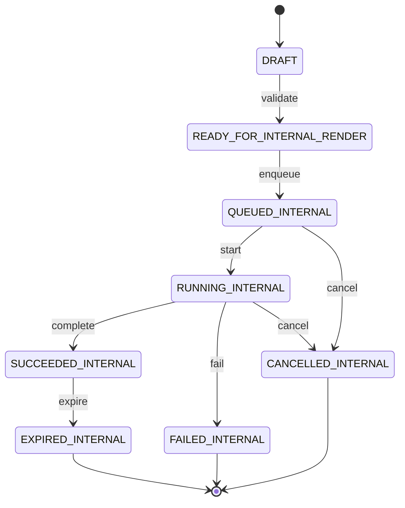

# FP-025 — Controlled Internal Render Job Lifecycle & Progress Orchestration

## 1. Status and Scope

| Field | Value |
|-------|-------|
| **Feature** | FP-025 |
| **Task** | Task 01 — Product + Engineering Design |
| **Status** | ✅ DESIGN COMPLETE |
| **Type** | Documentation only |
| **Code changes** | None |
| **Endpoint changes** | None |
| **Migration/schema/config** | None |

---

## 2. FP-024 Baseline Dependency

FP-025 builds directly on FP-024's closed foundation:

| FP-024 Component | FP-025 Uses |
|-------------------|-------------|
| TurkuRenderConfigValidator | Config gate before job creation |
| TurkuRenderWorkspaceValidator | Workspace validation during job setup |
| TurkuFfmpegExecutionGateway | Execution boundary (disabled/dry-run/simulated) |
| TurkuRenderArtifactVerifier | Artifact verification after execution |
| TurkuRenderArtifactMetadataIntegrationService | Metadata integration on job completion |
| TurkuRenderArtifactVerificationReport | Result attached to completed jobs |

FP-024 final baseline:
- Commit: d46cf6f
- Backend: 3660 tests, 0 failures
- Frontend: 1694 tests, 0 failures
- Endpoints: 44 = 25 POST + 19 GET
- Migration/schema/config: none

---

## 3. Product Goal

Enable a **safe internal render job lifecycle** that:
- Tracks render jobs through well-defined states
- Reports bounded progress to admin UI
- Connects to FP-024's artifact verification pipeline
- Remains internal-only — no public delivery
- Supports future controlled render orchestration

### User story
> Bir admin kullanıcı olarak, dahili render işinin durumunu ve ilerlemesini güvenli bir şekilde görmek istiyorum — yayın/indirme/dışa aktarım olmadan.

---

## 4. Non-Goals

FP-025 explicitly does NOT include:
- Publish/export/download capability
- Video player or rendered video playback
- Public/signed/CDN URL generation or exposure
- Real FFmpeg process execution (remains disabled-by-default from FP-024)
- Real filesystem file creation/deletion
- Database migration or schema changes
- Storage provider integration
- Binary/base64 upload or download
- Copyrighted lyrics/audio/video reproduction
- Auto-approval of render results
- Generic status update endpoint
- External delivery target

---

## 5. Standing Safety Baseline

All FP-001 → FP-024 safety rules remain in full effect:

| Rule | Status |
|------|:------:|
| No publish/export | ✅ |
| No download endpoint/button/link | ✅ |
| No video player / rendered video playback | ✅ |
| No public/signed/CDN URL | ✅ |
| No storage key exposure | ✅ |
| No filesystem path / workspace path / input/output path | ✅ |
| No executablePath / commandLine / shellCommand | ✅ |
| No base64 / binary content | ✅ |
| No raw provider/renderer payload | ✅ |
| No secret / apiKey | ✅ |
| No token / JWT / session / principal / authorizationHeader | ✅ |
| No unsafe HTML (dangerouslySetInnerHTML / innerHTML) | ✅ |
| No copyrighted lyrics / audio / video reproduction | ✅ |
| No auto-approval | ✅ |
| No generic status update | ✅ |
| humanReviewRequired = true | ✅ |
| autoApproved = false | ✅ |

---

## 6. Internal Render Job Model

### Job Identity

```
internal-render-job:{uuid}
```

- Opaque ref only — no database row ID, no storage key, no file path
- UUID generated at job creation time
- Not exposed externally
- Not a public identifier

### Job Request DTO

```
TurkuInternalRenderJobRequest
├── projectId: UUID
├── renderManifestRef: String (opaque)
├── requestedFormat: String (mp4 | webm)
├── requestedResolution: String (e.g. "1920x1080")
├── requestedFps: int (1–60)
├── requestedMaxDurationSeconds: double (0–600)
├── humanReviewRequired: boolean (always true)
├── copyrightReviewRequired: boolean (always true)
├── autoApproved: boolean (always false)
└── safetyFlags: List<String>
```

Forbidden fields:
- No binary/base64 upload field
- No delivery target
- No external URL
- No lyric/audio/video content field
- No auth/token/session field

### Job Result DTO

```
TurkuInternalRenderJobResult
├── jobRef: String (opaque, internal-render-job:{uuid})
├── status: TurkuInternalRenderJobStatus
├── completedAt: Instant | null
├── artifactVerificationRef: String | null (opaque)
├── verificationStatus: TurkuRenderArtifactVerificationStatus | null
├── humanReviewRequired: boolean (true)
├── copyrightReviewRequired: boolean (true)
├── autoApproved: boolean (false)
├── notPublishReady: boolean (true)
├── notExportReady: boolean (true)
├── safeErrorCode: String | null
├── safeMessage: String | null
├── safeTraceRef: String
└── safetyFlags: List<String>
```

Forbidden fields:
- No file location / path / URL
- No storage key
- No download/playback URL
- No raw stderr/stdout
- No provider payload
- No binary/base64

---

## 7. Lifecycle State Machine



### State Descriptions

| State | Description | Terminal |
|-------|-------------|:--------:|
| DRAFT | Job created, not yet validated | No |
| READY_FOR_INTERNAL_RENDER | Config/workspace/manifest validated | No |
| QUEUED_INTERNAL | Enqueued for internal execution | No |
| RUNNING_INTERNAL | Execution in progress (dry-run/simulated) | No |
| SUCCEEDED_INTERNAL | Execution completed with verified artifact | No |
| FAILED_INTERNAL | Execution failed safely | **Yes** |
| CANCELLED_INTERNAL | Cancelled by admin/system | **Yes** |
| EXPIRED_INTERNAL | Succeeded artifact expired per retention | **Yes** |

---

## 8. Allowed Transition Matrix

| From | To | Action | Validation |
|------|----|--------|------------|
| DRAFT | READY_FOR_INTERNAL_RENDER | `validate` | Config valid, workspace valid, manifest complete |
| READY_FOR_INTERNAL_RENDER | QUEUED_INTERNAL | `enqueue` | Not already queued |
| QUEUED_INTERNAL | RUNNING_INTERNAL | `start` | Execution boundary available |
| RUNNING_INTERNAL | SUCCEEDED_INTERNAL | `complete` | Artifact verified, humanReviewRequired=true |
| RUNNING_INTERNAL | FAILED_INTERNAL | `fail` | Safe error code assigned |
| RUNNING_INTERNAL | CANCELLED_INTERNAL | `cancel` | Explicit cancel action |
| QUEUED_INTERNAL | CANCELLED_INTERNAL | `cancel` | Explicit cancel action |
| SUCCEEDED_INTERNAL | EXPIRED_INTERNAL | `expire` | Retention policy elapsed |

Total allowed transitions: **8**

---

## 9. Forbidden Transitions

| From | To | Reason |
|------|----|--------|
| ANY | PUBLISHED | No publish state exists |
| ANY | EXPORTED | No export state exists |
| ANY | DELIVERED | No delivery state exists |
| DRAFT | SUCCEEDED_INTERNAL | Cannot bypass validation/execution |
| DRAFT | RUNNING_INTERNAL | Must validate first |
| FAILED_INTERNAL | RUNNING_INTERNAL | Terminal — no retry from failed |
| CANCELLED_INTERNAL | RUNNING_INTERNAL | Terminal — no restart from cancelled |
| EXPIRED_INTERNAL | ANY | Terminal — no resurrection |
| SUCCEEDED_INTERNAL | RUNNING_INTERNAL | Cannot re-run completed job |

Generic `setStatus(jobId, newStatus)` endpoint: **FORBIDDEN**

---

## 10. Progress / Readiness Model

### Progress Snapshot

```
TurkuInternalRenderJobProgress
├── jobRef: String (opaque)
├── status: TurkuInternalRenderJobStatus
├── progressPercent: int (0–100, bounded)
├── currentStageLabel: String (safe label only)
├── estimatedRemainingSeconds: int | null
├── humanReviewRequired: boolean (true)
├── autoApproved: boolean (false)
└── safetyFlags: List<String>
```

### Safe Stage Labels

| Percent Range | Label |
|:-------------:|-------|
| 0 | Hazırlanıyor |
| 1–10 | Yapılandırma doğrulanıyor |
| 11–30 | Çalışma alanı hazırlanıyor |
| 31–50 | Komut planı oluşturuluyor |
| 51–80 | Dahili render çalışıyor |
| 81–95 | Artifact doğrulanıyor |
| 96–100 | Tamamlandı |

### Progress Constraints

- progressPercent clamped to [0, 100]
- No raw stderr/stdout in stage labels
- No command line fragments in labels
- No file paths in labels
- No provider names in labels
- Labels are predefined enum/constant only

---

## 11. Safe Error / Reporting Model

### Error Codes

```
TurkuInternalRenderJobFailureCode
├── CONFIG_INVALID
├── WORKSPACE_INVALID
├── MANIFEST_INCOMPLETE
├── EXECUTION_DISABLED
├── EXECUTION_TIMEOUT
├── EXECUTION_FAILED_SAFE
├── ARTIFACT_VERIFICATION_FAILED
├── ARTIFACT_FORMAT_REJECTED
├── ARTIFACT_BOUNDS_EXCEEDED
├── ARTIFACT_REF_UNSAFE
├── RETENTION_EXPIRED
├── CANCELLED_BY_ADMIN
├── CANCELLED_BY_SYSTEM
└── GENERAL_FAILURE
```

### Reporting Rules

- Only safe error codes — never raw exception messages
- Only safe trace refs — never stack traces
- Only opaque artifact/job refs — never file paths
- Summary messages are predefined strings — never interpolated user/system content

---

## 12. Artifact Verification Handoff from FP-024

When a job transitions RUNNING_INTERNAL → SUCCEEDED_INTERNAL:

1. Execution result from `TurkuFfmpegExecutionGateway` (dry-run/simulated)
2. → `TurkuRenderArtifactVerifier.verifyFromExecution(result, plan)`
3. → `TurkuRenderArtifactVerificationReport`
4. → Report attached to job result as opaque verification ref
5. → `TurkuRenderArtifactMetadataIntegrationService.integrateFromExecution()`

The job result references the verification report by opaque ref only. No file path, storage key, or download URL is attached.

---

## 13. Admin UI Visibility Direction

### Planned Panels

| Panel | Content |
|-------|---------|
| Job Lifecycle Status | Current state, transition history (safe labels) |
| Progress Bar | 0–100%, current stage label |
| Readiness Summary | Config/workspace/manifest validation status |
| Artifact Verification | Opaque ref, format, bounds, verification status |
| Safety Labels | Turkish internal-only labels |

### Turkish Labels

- İş durumu: [state label]
- İlerleme: [percent]%
- Dahili render — yayın/indirme/dışa aktarım yok
- İnsan incelemesi gerekli
- Otomatik onay yok

### Not Present

- No video player
- No download/export/publish button
- No public/signed/CDN URL display
- No file path display
- No command line display
- No unsafe HTML

---

## 14. Backend Service / DTO / Boundary Direction

### Services

| Service | Responsibility |
|---------|---------------|
| TurkuInternalRenderJobService | Job creation, lifecycle management |
| TurkuInternalRenderJobTransitionValidator | Transition matrix enforcement |
| TurkuInternalRenderJobProgressService | Safe progress snapshots |

### DTOs

| DTO | Purpose |
|-----|---------|
| TurkuInternalRenderJobRequest | Job creation request |
| TurkuInternalRenderJobResult | Job completion result |
| TurkuInternalRenderJobProgress | Progress snapshot |
| TurkuInternalRenderJobSummary | Safe admin summary |
| TurkuInternalRenderJobSafetyEnvelope | Safety flags |

### Boundary Rules

- All DTOs use opaque refs only
- No forbidden fields in any DTO
- No generic `setStatus` method
- Transitions via explicit action methods: `validate()`, `enqueue()`, `start()`, `complete()`, `fail()`, `cancel()`, `expire()`
- Each transition validates preconditions

---

## 15. Endpoint Strategy

### Task 01: No new endpoints

### Later tasks (if needed):
- Prefer reusing existing FP-022 render endpoints
- If new endpoints required:
  - Explicit action endpoints only (e.g. `POST /api/v1/turku-video/{id}/render-job/validate`)
  - Never `PUT /api/v1/turku-video/{id}/render-job/status` (generic update)
  - No download/export/publish endpoints
  - Endpoint count must be explicitly tracked

---

## 16. Test Strategy

### Lifecycle Tests
- All 8 allowed transitions succeed
- All 9+ forbidden transitions rejected
- Terminal states (FAILED, CANCELLED, EXPIRED) cannot transition out
- DRAFT cannot skip to SUCCEEDED/RUNNING

### Progress Tests
- progressPercent clamped to [0, 100]
- Stage labels from predefined set only
- No raw stderr/stdout in progress
- No file paths in progress

### Safety Tests
- Job request DTO: 0 forbidden fields
- Job result DTO: 0 forbidden fields
- Progress DTO: 0 forbidden fields
- No publish/export/download/player
- humanReviewRequired always true
- autoApproved always false

### Backward Compatibility
- Existing FP-022/023/024 render execution unchanged
- StubTurkuRenderRunnerGateway remains default
- FFmpeg disabled-by-default unchanged
- Endpoint inventory unchanged unless explicitly expanded

---

## 17. Operational Risks and Rollback Boundaries

| Risk | Mitigation |
|------|-----------|
| Job gets stuck in RUNNING_INTERNAL | Timeout mechanism → FAILED_INTERNAL |
| Artifact ref leak | Opaque refs only, ref safety validation |
| State bypass | Transition validator, explicit actions only |
| Progress leak | Predefined labels only, clamped percent |
| Scope creep into delivery | No publish/export/download state or endpoint |

### Rollback
- FP-025 is additive — no existing behavior modified
- Rollback = remove FP-025 classes/tests/types
- FP-024 baseline remains stable

---

## 18. Proposed FP-025 Task Breakdown

| Task | Scope | Endpoints | Tests |
|------|-------|:---------:|:-----:|
| **01** | Product + engineering design doc | 0 | 0 |
| **02** | Backend lifecycle model + transition validator + safe DTOs + tests | 0 | ~30–40 |
| **03** | Backend job service + progress/readiness + boundary tests | 0 | ~25–35 |
| **04** | Admin UI job lifecycle/progress visibility + types + tests | 0 | ~50–70 |
| **05** | E2E lifecycle safety regression + final closure | 0 | 0–10 |

### Task Details

**Task 02**: Create `TurkuInternalRenderJobStatus`, `TurkuInternalRenderJobFailureCode`, `TurkuInternalRenderJobRequest`, `TurkuInternalRenderJobResult`, `TurkuInternalRenderJobProgress`, `TurkuInternalRenderJobSafetyEnvelope`, `TurkuInternalRenderJobTransitionValidator`. Tests for transition matrix, forbidden transitions, terminal states, forbidden fields.

**Task 03**: Create `TurkuInternalRenderJobService`, `TurkuInternalRenderJobProgressService`. Integrate with FP-024 config/workspace/execution/verification chain. Safe progress snapshots. Boundary and inventory tests.

**Task 04**: Frontend types for all FP-025 models. Job lifecycle panel, progress bar, readiness summary, safety labels. Component tests for panel rendering, forbidden field checks, no player/download/export/publish.

**Task 05**: Final E2E regression. Full backend + frontend test run. Safety scan. Endpoint inventory confirmation. Closure doc. FP-025 CLOSED.
