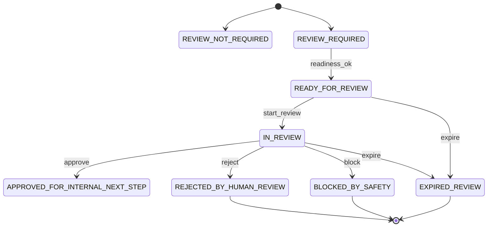

# FP-026 — Controlled Human Review Gate for Internal Render Readiness

## 1. Status and Scope

| Field | Value |
|-------|-------|
| **Feature** | FP-026 |
| **Task** | Task 01 — Product + Engineering Design |
| **Status** | ✅ DESIGN COMPLETE |
| **Type** | Documentation only |
| **Code changes** | None |
| **Endpoint changes** | None |
| **Migration/schema/config** | None |

---

## 2. FP-025 Baseline Dependency

FP-026 builds on FP-025's closed lifecycle/readiness/progress foundation:

| FP-025 Component | FP-026 Uses |
|-------------------|-------------|
| TurkuInternalRenderJobStatus | Job must be in reviewable state |
| TurkuInternalRenderJobSummary | Safe job context for reviewer |
| TurkuInternalRenderReadinessSnapshot | Readiness issues visible to reviewer |
| TurkuInternalRenderSafetyChainSnapshot | Safety chain status for review decision |
| TurkuInternalRenderJobProgress | Progress context (bounded, safe) |
| TurkuInternalRenderJobService | Service integration point |

FP-025 final baseline:
- Commit: 3683591
- Backend: 3741 tests, 0 failures
- Frontend: 1777 tests, 0 failures
- Endpoints: 44 = 25 POST + 19 GET
- Migration/schema/config: none

---

## 3. Product Goal

Enable a **controlled human review gate** that:
- Determines whether an internal render job is ready for human review
- Allows an admin reviewer to approve for internal-next-step or reject/block
- Preserves all safety guarantees — even after approval
- Remains internal-only — no public delivery after review

### User story
> Bir admin kullanıcı olarak, dahili render işinin insan incelemesi durumunu görmek, onaylamak veya reddetmek istiyorum — yayın/indirme/dışa aktarım olmadan.

### Key principle
**APPROVED_FOR_INTERNAL_NEXT_STEP ≠ publish/export/download/public delivery.**
Approval only gates the next internal orchestration step (e.g., retention, archival, future internal pipeline). It never gates public release.

---

## 4. Non-Goals

FP-026 explicitly does NOT include:
- Publish/export/download capability — even after human review approval
- Video/audio player for rendered artifact delivery
- Public/signed/CDN URL generation or exposure
- Auto-approval of any kind
- Generic status update
- Real FFmpeg process execution
- Real filesystem file creation/deletion
- Database migration or schema changes
- Storage provider integration
- Binary/base64 upload or download
- Copyrighted lyrics/audio/video reproduction
- Free-form unbounded reviewer notes (deferred)
- Public completion/release state

---

## 5. Standing Safety Baseline

All FP-001 → FP-025 safety rules remain in full effect:

| Rule | Status |
|------|:------:|
| No publish/export | ✅ |
| No download endpoint/button/link | ✅ |
| No video/audio player for rendered artifact | ✅ |
| No public/signed/CDN URL | ✅ |
| No storage key exposure | ✅ |
| No filesystem/workspace/input/output path | ✅ |
| No executablePath/commandLine/shellCommand | ✅ |
| No base64/binary content | ✅ |
| No raw provider/renderer payload | ✅ |
| No secret/apiKey | ✅ |
| No token/JWT/session/principal/authorizationHeader | ✅ |
| No unsafe HTML (dangerouslySetInnerHTML/innerHTML) | ✅ |
| No copyrighted lyrics/audio/video reproduction | ✅ |
| No auto-approval | ✅ |
| No generic status update | ✅ |
| humanReviewRequired = true | ✅ |
| autoApproved = false | ✅ |
| publicDeliveryAvailable = false | ✅ |

---

## 6. Human Review Gate Model

### Review Identity

```
internal-render-review:{uuid}
```

- Opaque ref only — no database row ID, no storage key, no file path
- UUID generated at review gate creation
- References job via opaque job ref: `internal-render-job:{uuid}`
- Not exposed externally
- Not a public identifier

### Review Decision DTO

```
TurkuInternalRenderReviewDecision
├── reviewRef: String (opaque, internal-render-review:{uuid})
├── jobRef: String (opaque, internal-render-job:{uuid})
├── reviewState: TurkuInternalRenderReviewState
├── action: TurkuInternalRenderReviewAction
├── reasonCode: TurkuInternalRenderReviewReasonCode
├── safeReviewLabel: String (predefined, bounded)
├── humanReviewRequired: boolean (true)
├── autoApproved: boolean (false — always)
├── publicDeliveryAvailable: boolean (false — always)
├── notPublishReady: boolean (true — always)
├── notExportReady: boolean (true — always)
├── safeTraceRef: String
└── safetyFlags: List<String>
```

Forbidden fields:
- No file path/storage key/URL
- No command line/executable path
- No binary/base64
- No provider/raw payload
- No secret/auth/token/session
- No free-form unbounded text (deferred)

---

## 7. Review States



| State | Description | Terminal |
|-------|-------------|:--------:|
| REVIEW_NOT_REQUIRED | Job does not need review (e.g., cancelled/expired) | No |
| REVIEW_REQUIRED | Human review is required | No |
| READY_FOR_REVIEW | Readiness checks pass, awaiting reviewer | No |
| IN_REVIEW | Reviewer is actively examining | No |
| APPROVED_FOR_INTERNAL_NEXT_STEP | Approved for internal-only next step | No |
| REJECTED_BY_HUMAN_REVIEW | Rejected by reviewer | **Yes** |
| BLOCKED_BY_SAFETY | Blocked due to safety violation | **Yes** |
| EXPIRED_REVIEW | Review window expired | **Yes** |

> **APPROVED_FOR_INTERNAL_NEXT_STEP** means: internal orchestration may proceed (retention, archival, future internal pipeline). It does **NOT** mean publish, export, download, or public delivery.

---

## 8. Review Actions

| Action | Purpose |
|--------|---------|
| REQUIRE_HUMAN_REVIEW | Mark job as requiring review |
| START_HUMAN_REVIEW | Begin reviewer examination |
| APPROVE_FOR_INTERNAL_NEXT_STEP | Approve for internal-only next step |
| REJECT_HUMAN_REVIEW | Reject the render job |
| BLOCK_FOR_SAFETY | Block due to safety concern |
| EXPIRE_HUMAN_REVIEW | Expire the review window |

### Forbidden actions (must never exist)
- AUTO_APPROVE
- APPROVE_FOR_PUBLIC_RELEASE
- APPROVE_FOR_PUBLISH
- APPROVE_FOR_EXPORT
- APPROVE_FOR_DOWNLOAD
- UPDATE_STATUS / SET_STATUS / PATCH_STATUS

---

## 9. Allowed Transition Matrix

| From | Action | To |
|------|--------|----|
| REVIEW_NOT_REQUIRED | REQUIRE_HUMAN_REVIEW | REVIEW_REQUIRED |
| REVIEW_REQUIRED | START_HUMAN_REVIEW | IN_REVIEW |
| REVIEW_REQUIRED | BLOCK_FOR_SAFETY | BLOCKED_BY_SAFETY |
| REVIEW_REQUIRED | EXPIRE_HUMAN_REVIEW | EXPIRED_REVIEW |
| READY_FOR_REVIEW | START_HUMAN_REVIEW | IN_REVIEW |
| READY_FOR_REVIEW | BLOCK_FOR_SAFETY | BLOCKED_BY_SAFETY |
| READY_FOR_REVIEW | EXPIRE_HUMAN_REVIEW | EXPIRED_REVIEW |
| IN_REVIEW | APPROVE_FOR_INTERNAL_NEXT_STEP | APPROVED_FOR_INTERNAL_NEXT_STEP |
| IN_REVIEW | REJECT_HUMAN_REVIEW | REJECTED_BY_HUMAN_REVIEW |
| IN_REVIEW | BLOCK_FOR_SAFETY | BLOCKED_BY_SAFETY |
| IN_REVIEW | EXPIRE_HUMAN_REVIEW | EXPIRED_REVIEW |

Total allowed transitions: **11**

---

## 10. Forbidden Transitions / Actions

| Rule | Reason |
|------|--------|
| No APPROVED → any active state | Cannot re-open approved review |
| No REJECTED → any active state | Terminal — no resurrection |
| No BLOCKED → any active state | Terminal — no resurrection |
| No EXPIRED → any active state | Terminal — no resurrection |
| No REVIEW_NOT_REQUIRED → IN_REVIEW | Must require first |
| No REVIEW_NOT_REQUIRED → APPROVED | Must go through review |
| No AUTO_APPROVE action | Auto-approval forbidden |
| No APPROVE_FOR_PUBLIC_RELEASE action | Public delivery forbidden |
| No generic UPDATE_STATUS | Explicit actions only |

---

## 11. Safe Review Decision / Result Model

### Review Summary DTO

```
TurkuInternalRenderReviewSummary
├── reviewRef: String (opaque)
├── jobRef: String (opaque)
├── reviewState: TurkuInternalRenderReviewState
├── safeReviewLabel: String (predefined Turkish label)
├── readinessStatus: TurkuInternalRenderReadinessStatus
├── safetyChainConfigValid: boolean
├── safetyChainWorkspaceSafe: boolean
├── safetyChainExecutionSafe: boolean
├── safetyChainArtifactVerified: boolean
├── humanReviewRequired: boolean (true)
├── autoApproved: boolean (false)
├── publicDeliveryAvailable: boolean (false)
├── notPublishReady: boolean (true)
├── notExportReady: boolean (true)
└── safetyFlags: List<String>
```

### Review Transition Result

```
TurkuInternalRenderReviewTransitionResult
├── allowed: boolean
├── fromState: TurkuInternalRenderReviewState
├── action: TurkuInternalRenderReviewAction
├── toState: TurkuInternalRenderReviewState | null
└── reasonCode: TurkuInternalRenderReviewReasonCode
```

---

## 12. Reason Code Model

```
TurkuInternalRenderReviewReasonCode
├── REVIEW_REQUIRED
├── READY_FOR_REVIEW
├── REVIEW_STARTED
├── APPROVED_INTERNAL_ONLY
├── REJECTED_BY_REVIEWER
├── BLOCKED_BY_SAFETY
├── REVIEW_EXPIRED
├── JOB_NOT_READY
├── READINESS_BLOCKED
├── ARTIFACT_VERIFICATION_FAILED
├── PUBLIC_DELIVERY_FORBIDDEN
├── AUTO_APPROVAL_FORBIDDEN
├── GENERIC_STATUS_UPDATE_FORBIDDEN
├── UNSAFE_REVIEW_INPUT_REJECTED
├── UNKNOWN_REVIEW_STATE
├── UNKNOWN_REVIEW_ACTION
├── TRANSITION_NOT_ALLOWED
└── TERMINAL_STATE
```

Total: **18 safe bounded codes**

---

## 13. FP-025 Readiness Integration

FP-026 consumes FP-025 readiness data safely:

| FP-025 Source | FP-026 Usage |
|---------------|-------------|
| TurkuInternalRenderReadinessSnapshot.status | Determines if READY_FOR_REVIEW |
| TurkuInternalRenderReadinessSnapshot.issues | Displayed as safe issue labels to reviewer |
| TurkuInternalRenderSafetyChainSnapshot | Config/workspace/execution/artifact status booleans |
| TurkuInternalRenderJobSummary | Job ref, status, progress for context |
| TurkuInternalRenderJobProgress | Bounded progress display |

**Only status/issue/boolean/opaque ref data may be used.**
No paths, commands, storage keys, URLs, provider payloads, logs, stdout/stderr, binary/base64.

### Gate logic
- If readiness = READY_INTERNAL_ONLY → review gate can become READY_FOR_REVIEW
- If readiness = BLOCKED_BY_* → review gate stays REVIEW_REQUIRED (cannot proceed)
- If safety chain has any false → review gate may BLOCK_FOR_SAFETY
- humanReviewRequired always true
- autoApproved always false

---

## 14. Admin UI Direction

### Planned Panels

| Panel | Content |
|-------|---------|
| Review Gate Status | Current review state, safe label |
| Readiness Context | Issues, safety chain summary |
| Review Actions | Approve/Reject/Block buttons (internal-only labels) |
| Safety Labels | Turkish internal-only labels |

### Turkish Labels
- İnceleme durumu: [state]
- İnsan incelemesi gerekli
- Otomatik onay kapalı
- Yayın/Dışa aktarım yok — onay sonrası dahil
- Dahili sonraki adım için onaylandı — yayın DEĞİL
- Reddedildi
- Güvenlik nedeniyle engellendi
- İnceleme süresi doldu
- Public/CDN URL yok
- Video oynatıcı yok
- İndirilebilir video yok

### Approve Button Label
**"Dahili Sonraki Adım İçin Onayla"** — explicitly NOT "Yayınla" / "Dışa Aktar" / "İndir"

### Not Present
- No video player
- No download/export/publish button
- No public URL display
- No file path/command/storage display
- No unsafe HTML
- No auto-approve button

---

## 15. Backend Service / DTO / Boundary Direction

### Services

| Service | Responsibility |
|---------|---------------|
| TurkuInternalRenderReviewGateService | Review creation, lifecycle, decisions |
| TurkuInternalRenderReviewTransitionValidator | Transition matrix enforcement |

### DTOs

| DTO | Purpose |
|-----|---------|
| TurkuInternalRenderReviewDecision | Review action + result |
| TurkuInternalRenderReviewSummary | Safe admin summary |
| TurkuInternalRenderReviewTransitionResult | Transition allowed/denied |

### Boundary Rules
- All DTOs use opaque refs only
- No forbidden fields
- No generic setStatus method
- Transitions via explicit action methods
- humanReviewRequired = true always
- autoApproved = false always
- publicDeliveryAvailable = false always

---

## 16. Endpoint Strategy

### Task 01: No new endpoints

### Later tasks (if needed):
- Prefer reusing existing render workflow endpoints
- If new endpoints required:
  - Explicit action endpoints only
  - Never generic `PUT /status` or `PATCH /status`
  - No download/export/publish endpoints
  - Endpoint count must be explicitly tracked

---

## 17. Test Strategy

### Review Gate Tests
- All 11 allowed transitions succeed
- All forbidden transitions rejected
- Terminal states (REJECTED, BLOCKED, EXPIRED) cannot transition out
- APPROVED cannot re-open
- No auto-approve action exists
- No public delivery action exists

### Safety Tests
- Review DTOs: 0 forbidden fields
- No publish/export/download methods
- humanReviewRequired always true
- autoApproved always false
- publicDeliveryAvailable always false

### Readiness Integration Tests
- READY readiness → READY_FOR_REVIEW
- BLOCKED readiness → stays REVIEW_REQUIRED
- Safety chain false → BLOCK_FOR_SAFETY possible

### UI Tests
- Review panels render
- Approve label is internal-only
- No player/download/export/publish controls
- Turkish safety labels present
- No forbidden exposure

### Endpoint/Backward Tests
- Endpoint inventory unchanged unless explicitly expanded
- FP-019–025 backward compatible

---

## 18. Operational Risks and Rollback Boundaries

| Risk | Mitigation |
|------|-----------|
| Reviewer interprets "approved" as public release | UI label explicitly says "Dahili Sonraki Adım" |
| Review stuck in IN_REVIEW | Expire mechanism → EXPIRED_REVIEW |
| Safety bypass attempt | BLOCK_FOR_SAFETY + terminal state |
| State resurrection from terminal | Transition validator denies |
| Scope creep into delivery | No publish/export/download state/action/endpoint |

### Rollback
- FP-026 is additive — no existing behavior modified
- Rollback = remove FP-026 classes/tests/types
- FP-025 baseline remains stable

---

## 19. Proposed FP-026 Task Breakdown

| Task | Scope | Endpoints | Tests |
|------|-------|:---------:|:-----:|
| **01** | Product + engineering design doc | 0 | 0 |
| **02** | Backend review gate model + transition validator + safe DTOs + tests | 0 | ~35–45 |
| **03** | Backend review gate service + readiness integration + boundary tests | 0 | ~25–35 |
| **04** | Admin UI review gate visibility/actions + types + tests | 0 | ~60–80 |
| **05** | E2E review gate safety regression + final closure | 0 | 0–10 |

### Task Details

**Task 02**: Create TurkuInternalRenderReviewState, TurkuInternalRenderReviewAction, TurkuInternalRenderReviewReasonCode, TurkuInternalRenderReviewRef, TurkuInternalRenderReviewTransitionResult, TurkuInternalRenderReviewTransitionValidator, TurkuInternalRenderReviewDecision, TurkuInternalRenderReviewSummary. Tests for transition matrix, forbidden transitions, terminal states, forbidden fields, no auto-approve.

**Task 03**: Create TurkuInternalRenderReviewGateService. Integrate with FP-025 readiness/safety-chain. Review creation, action dispatch, readiness-gated transitions. Boundary and inventory tests.

**Task 04**: Frontend types for all FP-026 models. Review gate panel, readiness context panel, approve/reject/block labels (internal-only), Turkish safety labels. Component tests for panel rendering, forbidden fields, no player/download/export/publish.

**Task 05**: Final E2E regression. Full backend + frontend test run. Safety scan. Endpoint inventory confirmation. Closure doc. FP-026 CLOSED.
