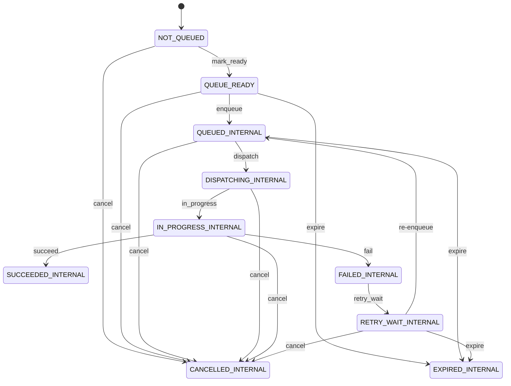

# FP-027 — Internal Render Queue / Retry / Expiration Policy

## 1. Status and Scope

| Field | Value |
|-------|-------|
| **Feature** | FP-027 |
| **Task** | Task 01 — Product + Engineering Design |
| **Status** | ✅ DESIGN COMPLETE |
| **Type** | Documentation only |
| **Code changes** | None |
| **Endpoint changes** | None |
| **Migration/schema/config** | None |

---

## 2. FP-024/025/026 Baseline Dependency

| Feature | Provides | Final Commit |
|---------|----------|:------------:|
| FP-024 | Internal render config/workspace/execution/artifact verification | d46cf6f |
| FP-025 | Internal render job lifecycle/progress/readiness | 3683591 |
| FP-026 | Human review gate for internal render readiness | fbe9afc |

FP-027 builds on all three:
- FP-024: execution boundary + artifact verification required before dispatch
- FP-025: job lifecycle state + readiness snapshot consumed safely
- FP-026: human review approval required (internal next step) before dispatch where applicable

Current baseline:
- Backend: 3808 tests, 0 failures
- Frontend: 1858 tests, 0 failures
- Endpoints: 44 = 25 POST + 19 GET
- Migration/schema/config: none

---

## 3. Product Goal

Enable a **controlled internal render queue** with bounded retry and expiration policies:

> Bir admin kullanıcı olarak, dahili render işlerinin kuyruk durumunu, yeniden deneme sayısını ve süre aşımı durumunu görmek istiyorum — yayın/indirme/dışa aktarım olmadan.

### Key principles
- Queue is internal-only — no public delivery queue
- Retry is bounded — max 5 attempts, bounded delay
- Expiration is bounded — items expire after configurable safe duration
- Dispatch requires FP-025 readiness + FP-026 review approval (where applicable)
- All states/actions are explicit — no generic status update

---

## 4. Non-Goals

FP-027 explicitly does NOT include:
- Publish/export/download capability
- Video/audio player
- Public/signed/CDN URL generation
- Auto-approval
- Generic status update
- Real FFmpeg execution (unless gated by FP-024 disabled-by-default)
- Real filesystem file creation/deletion
- Database migration or schema changes
- Storage provider integration
- Binary/base64 upload or download
- Artifact deletion/purge behavior
- Copyrighted lyrics/audio/video reproduction
- Public delivery queue

---

## 5. Standing Safety Baseline

All FP-001 → FP-026 safety rules remain:

| Rule | Status |
|------|:------:|
| No publish/export | ✅ |
| No download endpoint/button/link | ✅ |
| No video/audio player | ✅ |
| No public/signed/CDN URL | ✅ |
| No storage key exposure | ✅ |
| No filesystem/workspace/input/output path | ✅ |
| No executablePath/commandLine/shellCommand | ✅ |
| No base64/binary content | ✅ |
| No raw provider/renderer payload | ✅ |
| No secret/apiKey | ✅ |
| No token/JWT/session/principal/authorizationHeader | ✅ |
| No unsafe HTML | ✅ |
| No copyrighted reproduction | ✅ |
| No auto-approval | ✅ |
| No generic status update | ✅ |
| humanReviewRequired = true | ✅ |
| autoApproved = false | ✅ |
| publicDeliveryAvailable = false | ✅ |

---

## 6. Internal Queue Model

### Queue Item Identity

```
internal-render-queue-item:{uuid}
```

- Opaque ref only — no database row ID, no storage key, no file path
- UUID generated at queue item creation
- References job via opaque ref: `internal-render-job:{uuid}`
- Optionally references review via opaque ref: `internal-render-review:{uuid}`
- Not exposed externally
- Not a public identifier

### Queue Item DTO

```
TurkuInternalRenderQueueItem
├── queueItemRef: String (opaque)
├── jobRef: String (opaque)
├── reviewRef: String (opaque, optional)
├── queueState: TurkuInternalRenderQueueState
├── attemptNumber: int (bounded 0–5)
├── maxAttempts: int (bounded 1–5)
├── retryDelaySeconds: int (bounded, safe)
├── humanReviewRequired: boolean (true)
├── autoApproved: boolean (false — always)
├── publicDeliveryAvailable: boolean (false — always)
├── internalOnly: boolean (true — always)
├── notPublishReady: boolean (true — always)
├── notExportReady: boolean (true — always)
├── safeTraceRef: String
└── safetyFlags: List<String>
```

---

## 7. Queue States and Actions

### States (10)



| State | Terminal | Description |
|-------|:--------:|-------------|
| NOT_QUEUED | No | Initial — item not in queue |
| QUEUE_READY | No | Prerequisites met, ready for queuing |
| QUEUED_INTERNAL | No | Waiting in internal queue |
| DISPATCHING_INTERNAL | No | Being dispatched to execution |
| IN_PROGRESS_INTERNAL | No | Execution in progress |
| RETRY_WAIT_INTERNAL | No | Waiting before retry attempt |
| SUCCEEDED_INTERNAL | **Yes** | Completed successfully (internal) |
| FAILED_INTERNAL | **Yes** | Failed permanently (max retries exhausted) |
| CANCELLED_INTERNAL | **Yes** | Cancelled by admin/system |
| EXPIRED_INTERNAL | **Yes** | Expired due to timeout |

### Actions (9)

| Action | Purpose |
|--------|---------|
| MARK_QUEUE_READY | Mark item as ready for queuing |
| ENQUEUE_INTERNAL | Add to internal queue |
| DISPATCH_INTERNAL | Begin dispatch to execution |
| MARK_IN_PROGRESS | Mark execution started |
| MARK_RETRY_WAIT | Move to retry wait after failure |
| MARK_SUCCEEDED | Mark execution succeeded |
| MARK_FAILED | Mark execution permanently failed |
| CANCEL_INTERNAL | Cancel the queue item |
| EXPIRE_INTERNAL | Expire the queue item |

### Forbidden Actions (must never exist)
- AUTO_APPROVE
- PUBLISH / EXPORT / DOWNLOAD
- PUBLIC_DELIVERY
- UPDATE_STATUS / SET_STATUS / PATCH_STATUS
- APPROVE_FOR_PUBLIC_RELEASE

---

## 8. Allowed Transition Matrix

| From | Action | To |
|------|--------|----|
| NOT_QUEUED | MARK_QUEUE_READY | QUEUE_READY |
| QUEUE_READY | ENQUEUE_INTERNAL | QUEUED_INTERNAL |
| QUEUED_INTERNAL | DISPATCH_INTERNAL | DISPATCHING_INTERNAL |
| DISPATCHING_INTERNAL | MARK_IN_PROGRESS | IN_PROGRESS_INTERNAL |
| IN_PROGRESS_INTERNAL | MARK_SUCCEEDED | SUCCEEDED_INTERNAL |
| IN_PROGRESS_INTERNAL | MARK_FAILED | FAILED_INTERNAL |
| IN_PROGRESS_INTERNAL | MARK_RETRY_WAIT | RETRY_WAIT_INTERNAL |
| RETRY_WAIT_INTERNAL | ENQUEUE_INTERNAL | QUEUED_INTERNAL |
| NOT_QUEUED | CANCEL_INTERNAL | CANCELLED_INTERNAL |
| QUEUE_READY | CANCEL_INTERNAL | CANCELLED_INTERNAL |
| QUEUED_INTERNAL | CANCEL_INTERNAL | CANCELLED_INTERNAL |
| DISPATCHING_INTERNAL | CANCEL_INTERNAL | CANCELLED_INTERNAL |
| IN_PROGRESS_INTERNAL | CANCEL_INTERNAL | CANCELLED_INTERNAL |
| RETRY_WAIT_INTERNAL | CANCEL_INTERNAL | CANCELLED_INTERNAL |
| QUEUE_READY | EXPIRE_INTERNAL | EXPIRED_INTERNAL |
| QUEUED_INTERNAL | EXPIRE_INTERNAL | EXPIRED_INTERNAL |
| RETRY_WAIT_INTERNAL | EXPIRE_INTERNAL | EXPIRED_INTERNAL |

Total allowed transitions: **17**

---

## 9. Forbidden Transitions / Actions

| Rule | Reason |
|------|--------|
| No SUCCEEDED → any active state | Terminal — no resurrection |
| No FAILED → any active state (except RETRY_WAIT if retriable) | Permanent failure is terminal |
| No CANCELLED → any active state | Terminal |
| No EXPIRED → any active state | Terminal |
| No NOT_QUEUED → IN_PROGRESS | Must go through queue |
| No QUEUE_READY → IN_PROGRESS | Must enqueue + dispatch first |
| No generic UPDATE_STATUS | Explicit actions only |
| No AUTO_APPROVE / PUBLISH / EXPORT / DOWNLOAD | Forbidden |

---

## 10. Retry Policy

### Bounded Retry Value Object

```
TurkuInternalRenderRetryPolicy
├── maxAttempts: int (1–5, default 3)
├── retryDelaySeconds: int (bounded, e.g. 30–600)
├── currentAttempt: int (0–maxAttempts)
├── retriable: boolean (derived)
└── retryReasonCode: TurkuInternalRenderRetryReasonCode
```

### Retry Reason Codes
- EXECUTION_FAILED_RETRIABLE
- TIMEOUT_RETRIABLE
- TRANSIENT_ERROR_RETRIABLE
- MAX_RETRIES_EXHAUSTED
- NOT_RETRIABLE_PERMANENT
- CANCELLED_NO_RETRY
- EXPIRED_NO_RETRY

### Rules
- `retriable = currentAttempt < maxAttempts && state allows retry`
- Failed with max retries exhausted → FAILED_INTERNAL (terminal)
- No unbounded retry loops
- No raw error/log/stderr/stdout in retry reason
- No provider payload in retry metadata

---

## 11. Expiration Policy

### Bounded Expiration Value Object

```
TurkuInternalRenderExpirationPolicy
├── maxQueueDurationSeconds: int (bounded, e.g. 3600)
├── maxRetryWaitDurationSeconds: int (bounded, e.g. 1800)
├── expired: boolean (derived)
└── expirationReasonCode: TurkuInternalRenderExpirationReasonCode
```

### Expiration Reason Codes
- QUEUE_DURATION_EXCEEDED
- RETRY_WAIT_DURATION_EXCEEDED
- STALE_INTERNAL_STATE
- ADMIN_FORCED_EXPIRATION
- NOT_EXPIRED

### Rules
- Items in QUEUE_READY / QUEUED_INTERNAL / RETRY_WAIT_INTERNAL can expire
- IN_PROGRESS items do not auto-expire (use CANCEL instead)
- No filesystem cleanup in this feature
- No artifact deletion/purge in this feature

---

## 12. Dispatch Readiness Safety

### Prerequisites for DISPATCH_INTERNAL

| Check | Source |
|-------|--------|
| Job readiness = READY_INTERNAL_ONLY | FP-025 TurkuInternalRenderReadinessSnapshot |
| Safety chain safe | FP-025 TurkuInternalRenderSafetyChainSnapshot |
| Human review = APPROVED_FOR_INTERNAL_NEXT_STEP | FP-026 TurkuInternalRenderReviewState |
| Retry attempts < maxAttempts | FP-027 TurkuInternalRenderRetryPolicy |
| Not expired | FP-027 TurkuInternalRenderExpirationPolicy |

Dispatch does NOT enable:
- Public delivery
- Real FFmpeg execution (unless FP-024 gate allows)
- Storage provider upload
- Public URL generation

---

## 13. Safe DTO / Result Model

### Queue Transition Result

```
TurkuInternalRenderQueueTransitionResult
├── allowed: boolean
├── fromState: TurkuInternalRenderQueueState
├── action: TurkuInternalRenderQueueAction
├── toState: TurkuInternalRenderQueueState | null
├── reasonCode: TurkuInternalRenderQueueReasonCode
└── attemptNumber: int
```

### Queue Summary

```
TurkuInternalRenderQueueSummary
├── queueItemRef: String (opaque)
├── jobRef: String (opaque)
├── queueState: TurkuInternalRenderQueueState
├── attemptNumber: int
├── maxAttempts: int
├── retriable: boolean
├── expired: boolean
├── humanReviewRequired: boolean (true)
├── autoApproved: boolean (false)
├── publicDeliveryAvailable: boolean (false)
├── internalOnly: boolean (true)
└── safetyFlags: List<String>
```

Forbidden fields: filePath, absolutePath, workspacePath, inputPath, outputPath, storageKey, publicUrl, signedUrl, cdnUrl, executablePath, commandLine, shellCommand, base64, binary, providerPayload, rawPayload, secret, apiKey, Authorization, Bearer, JWT, token, session, principal.

---

## 14. Admin UI Direction

### Planned Panels

| Panel | Content |
|-------|---------|
| Queue Status | State, attempt count, internal-only |
| Retry Status | Current/max attempts, retriable flag, delay |
| Expiration Status | Expired flag, reason |
| Safety Labels | Turkish internal-only labels |

### Turkish Labels
- Dahili render kuyruğu
- Kuyruk durumu: [state]
- Deneme sayısı: [n]/[max]
- Yeniden deneme bekleniyor
- Süre aşımı doldu
- İptal edildi
- Başarılı (dahili)
- İnsan onayı gerekli
- Otomatik onay kapalı
- Yayın/Dışa aktarım yok
- Public/CDN URL yok
- Dosya yolu gösterilmez
- Komut satırı gösterilmez

### Not Present
- No video player / download / export / publish
- No unsafe HTML
- No auth/token/session display

---

## 15. Backend Service / DTO / Boundary Direction

### Services

| Service | Responsibility |
|---------|---------------|
| TurkuInternalRenderQueueService | Queue lifecycle, dispatch, retry, expiration |
| TurkuInternalRenderQueueTransitionValidator | 17-transition matrix enforcement |

### DTOs

| DTO | Purpose |
|-----|---------|
| TurkuInternalRenderQueueItem | Queue item with opaque refs |
| TurkuInternalRenderQueueSummary | Safe admin summary |
| TurkuInternalRenderQueueTransitionResult | Transition allowed/denied |
| TurkuInternalRenderRetryPolicy | Bounded retry config |
| TurkuInternalRenderExpirationPolicy | Bounded expiration config |

---

## 16. Endpoint Strategy

### Task 01: No new endpoints

### Later tasks (if needed):
- Explicit action endpoints only
- Never generic PUT /status or PATCH /status
- No download/export/publish endpoints

---

## 17. Test Strategy

### Queue Tests
- All 17 allowed transitions succeed
- Forbidden transitions rejected
- Terminal states deny resurrection
- No generic status update action

### Retry Tests
- Bounded 0–5 attempts
- Max retries exhausted → FAILED_INTERNAL
- Retry wait → re-enqueue cycle
- No unbounded retry

### Expiration Tests
- Queue/retry-wait items expire
- In-progress items do not auto-expire
- Expiration is terminal

### Safety Tests
- Queue DTOs: 0 forbidden fields
- No publish/export/download methods
- humanReviewRequired=true, autoApproved=false, publicDeliveryAvailable=false

### Integration Tests
- FP-025 readiness consumed safely
- FP-026 review gate consumed safely
- Dispatch blocked without prerequisites

### UI Tests
- Panels render
- No player/download/export/publish
- Turkish labels present

---

## 18. Operational Risks and Rollback Boundaries

| Risk | Mitigation |
|------|-----------|
| Unbounded retry loop | maxAttempts capped at 5 |
| Queue item stuck forever | Expiration policy |
| Dispatch without review | FP-026 review gate required |
| Scope creep into delivery | No publish/export/download state/action |

### Rollback
- FP-027 is additive — no existing behavior modified
- Rollback = remove FP-027 classes/tests/types
- FP-024/025/026 baseline remains stable

---

## 19. Proposed FP-027 Task Breakdown

| Task | Scope | Endpoints | Tests |
|------|-------|:---------:|:-----:|
| **01** | Product + engineering design doc | 0 | 0 |
| **02** | Backend queue model + transition validator + retry/expiration value objects + safe DTOs + tests | 0 | ~45–55 |
| **03** | Backend queue service + FP-025/FP-026 integration + boundary tests | 0 | ~25–35 |
| **04** | Admin UI queue/retry/expiration visibility + types + tests | 0 | ~60–80 |
| **05** | E2E queue safety regression + final closure | 0 | 0–10 |

### Task Details

**Task 02**: Create TurkuInternalRenderQueueState, TurkuInternalRenderQueueAction, TurkuInternalRenderQueueReasonCode, TurkuInternalRenderQueueItemRef, TurkuInternalRenderQueueTransitionResult, TurkuInternalRenderQueueTransitionValidator, TurkuInternalRenderRetryPolicy, TurkuInternalRenderExpirationPolicy, TurkuInternalRenderQueueSummary. Tests for 17-transition matrix, retry bounds, expiration bounds, forbidden fields.

**Task 03**: Create TurkuInternalRenderQueueService. Integrate with FP-025 readiness/safety-chain + FP-026 review gate. Queue creation, action dispatch, retry cycle, expiration check. Boundary and inventory tests.

**Task 04**: Frontend types for all FP-027 models. Queue status, retry, expiration panels. Turkish safety labels. Component tests.

**Task 05**: Final E2E regression. Full backend + frontend test run. Safety scan. Endpoint inventory. Closure doc. FP-027 CLOSED.
