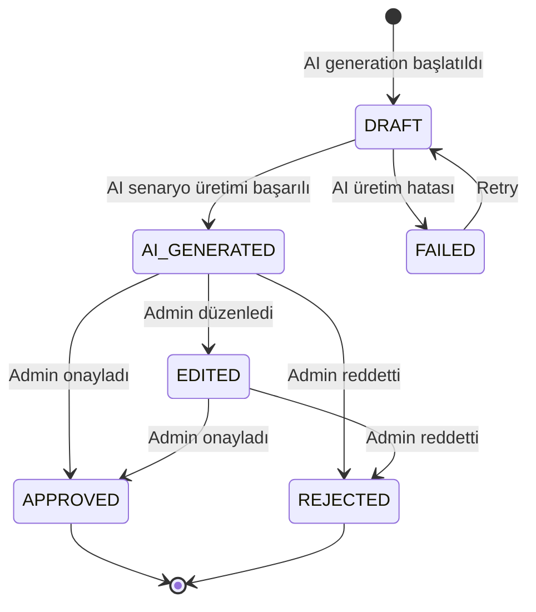

# 35 — FP-002 Scenario Generation Workflow — Product Design

> **Status**: 📋 DESIGN / PLANNING
>
> **Feature**: FP-002 — Scenario Generation Workflow
>
> **Prerequisite**: FP-001 — AI Assisted Content Creation (CLOSED)

---

## 1. Feature Objective

FP-002, onaylanmış (APPROVED) içerik draft'larından yapılandırılmış
video senaryoları üretmeyi sağlar.

**Amaçlar:**

- Approved content draft'tan yapılandırılmış senaryo üretimi
- İnsan review sürecinin korunması (FP-001 governance devam)
- Storyboard/media workflow'larına temiz handoff hazırlığı
- FP-001'de inşa edilen AI provider altyapısının yeniden kullanımı
- Provider sınırlarının değiştirilmemesi

**Ürün Değeri:**

Kullanıcı bir konu girdikten sonra AI draft oluşturur (FP-001) →
draft onaylanır → FP-002 ile bu draft'tan **yapılandırılmış senaryo**
üretilir: Hook, Giriş, Hikâye, Duygusal Zirve, Kapanış, CTA. Bu senaryo,
ileride storyboard ve video üretim sürecinin girdisi olacaktır.

---

## 2. Terminology

| Terim | Tanım |
|-------|-------|
| Content Draft | FP-001'de AI tarafından üretilen ve admin tarafından onaylanan metin taslağı |
| Scenario | Content Draft'tan üretilen yapılandırılmış video senaryosu |
| ScriptDraft | Domain model'deki entity adı (02-domain-model.md ile tutarlı) |
| Beat | Senaryo içindeki anlatım birimi (Hook, Giriş, vb.) |

> **Not**: Domain model'de bu entity `ScriptDraft` olarak planlanmıştır.
> FP-002 implementasyonunda bu isimlendirme korunacaktır.

---

## 3. In Scope

| # | Kapsam |
|---|--------|
| 1 | Approved content draft'tan senaryo generation |
| 2 | Senaryo adayı (ScriptDraft) oluşturma |
| 3 | Admin tarafından senaryo review/edit |
| 4 | Admin tarafından explicit senaryo approve |
| 5 | Admin tarafından senaryo reject veya regeneration |
| 6 | Admin UI'da senaryo list/detail görünürlüğü |
| 7 | Senaryo lifecycle dokümantasyonu |
| 8 | Product-level validation kuralları |
| 9 | AI generation retry/error handling (FP-001 pattern) |

---

## 4. Out of Scope

| # | Kapsam Dışı | Neden |
|---|-------------|-------|
| 1 | Storyboard generation | FP-003 |
| 2 | Görsel üretimi | Sonraki feature |
| 3 | Video üretimi | Sonraki feature |
| 4 | Ses üretimi | Sonraki feature |
| 5 | Scheduled publishing | Ayrı feature |
| 6 | Public publishing | Ayrı feature |
| 7 | Prompt management UI | Ayrı feature |
| 8 | Cost dashboard | OPS feature |
| 9 | Multi-provider selection UI | Ayrı feature |
| 10 | Otomatik approval | Governance kuralı — yasak |
| 11 | Otomatik ready-for-publish | Governance kuralı — yasak |
| 12 | Bulk generation | Sonraki feature |
| 13 | Public-facing senaryo sayfaları | Sonraki feature |

---

## 5. Scenario Lifecycle

### State Machine



### Status Değerleri

| Status | Açıklama | Kim tetikler |
|--------|----------|-------------|
| `DRAFT` | AI üretimi başlatıldı/bekliyor | Sistem |
| `AI_GENERATED` | AI tarafından üretildi, review bekliyor | AI Provider |
| `EDITED` | Admin tarafından düzenlendi | Admin |
| `APPROVED` | Admin tarafından onaylandı | Admin (explicit) |
| `REJECTED` | Admin tarafından reddedildi | Admin (explicit) |
| `FAILED` | AI üretimi başarısız | Sistem |

### FP-001 ile Karşılaştırma

| Alan | FP-001 ContentDraft | FP-002 ScriptDraft |
|------|---------------------|---------------------|
| Status enum | GENERATED, EDITED, REVISION_NEEDED, APPROVED, REJECTED | DRAFT, AI_GENERATED, EDITED, APPROVED, REJECTED, FAILED |
| Auto-approve | ❌ Yok | ❌ Yok |
| Auto-publish | ❌ Yok | ❌ Yok |
| Human review | ✅ Zorunlu | ✅ Zorunlu |
| Retry | ContentProject üzerinden | Scenario üzerinden |

> **Tasarım kararı**: FP-001'de FAILED status ContentProject'te
> tutuluyordu. FP-002'de FAILED status doğrudan ScriptDraft'ta
> tutulacak — bu daha temiz bir model sağlar ve retry logic'i
> basitleştirir.

### Domain Model Uyumu

Domain model'de (02-domain-model.md) ScriptDraft zaten planlanmıştır:

```
ScriptDraft
├── id
├── content_project_id
├── version
├── title
├── body
├── status (DRAFT, AI_GENERATED, HUMAN_REVIEWED, APPROVED, REJECTED)
├── created_by
└── created_at
```

FP-002 bu modeli temel alacak ve gerekli alanları genişletecektir.

---

## 6. Human Review Rules

### Zorunlu Kurallar

| # | Kural | Kaynak |
|---|-------|--------|
| 1 | Senaryo approval = explicit admin action | FP-001 governance |
| 2 | Senaryo rejection = explicit admin action | FP-001 governance |
| 3 | Senaryo edit, approval öncesi mümkün olmalı | UX gereksinimi |
| 4 | Regeneration, approved senaryoyu overwrite etmemeli | Veri bütünlüğü |
| 5 | Approved draft gerekli — unapproved draft'tan senaryo üretilemez | İş kuralı |
| 6 | AI, senaryoyu otomatik olarak APPROVED yapamaz | Governance |
| 7 | AI, senaryoyu otomatik olarak READY_FOR_PUBLISH yapamaz | Governance |
| 8 | Generic status update endpoint yok | Governance |
| 9 | Generic status dropdown yok | Governance |

### Regeneration Davranışı

Regeneration iki senaryoda gerçekleşebilir:

**A) Henüz approve edilmemiş senaryo varken:**
- Mevcut AI_GENERATED/EDITED senaryo korunur (version tracking)
- Yeni version üretilir
- Admin hangi version'ı approve edeceğini seçer

**B) Approved senaryo varken:**
- Approved senaryo dokunulmaz
- Yeni version oluşturulabilir (draft olarak)
- Yeni version ayrı bir review sürecinden geçer
- Admin yeni version'ı approve ederse, eski version'ın durumu değişmez

### Prerequisite Kontrolü

```
Content Project status == APPROVED
  └── latestDraftId != null
       └── ContentDraft status == APPROVED veya EDITED
            └── Senaryo generation başlatılabilir
```

> **Basitleştirme**: MVP'de `ContentProject.status == APPROVED` kontrolü
> yeterlidir. Draft'ın kendisi zaten approve flow'undan geçmiştir.

---

## 7. Admin UX Flow

### 7.1 Senaryo Generation Başlangıcı

**Nereden başlar:**
- Content Project detay sayfasında, project status `APPROVED` olduğunda
- "Senaryo Üret" butonu görünür hale gelir
- Buton sadece APPROVED project'lerde aktif

**Admin ne görür (generate öncesi):**
- Content Project özeti (başlık, KI bilgisi, approved draft preview)
- "Senaryo Üret" CTA butonu
- Mevcut senaryo varsa: version listesi

### 7.2 Generation Sırasında

**Loading state:**
- "Senaryo üretiliyor..." spinner/progress
- Buton disabled
- Tahmini süre bilgisi (opsiyonel)

**Başarı:**
- "Senaryo başarıyla üretildi" bildirim
- Otomatik senaryo detay sayfasına yönlendirme
- Status badge: `AI_GENERATED`

**Hata:**
- Hata mesajı (user-friendly, provider detayı yok)
- "Tekrar Dene" butonu
- Hata tipi badge (opsiyonel)

### 7.3 Senaryo Review

**Admin ne görür (generation sonrası):**

```
┌─────────────────────────────────────────────────────┐
│ Senaryo: Truva Atı'nın Hikayesi — v1                │
│ Status: AI_GENERATED                                 │
├─────────────────────────────────────────────────────┤
│                                                       │
│ 🎯 Hook                                              │
│ ┌─────────────────────────────────────────────────┐  │
│ │ "Antik çağın en kurnaz savaş planı..."           │  │
│ └─────────────────────────────────────────────────┘  │
│                                                       │
│ 📖 Giriş                                             │
│ ┌─────────────────────────────────────────────────┐  │
│ │ Truva Savaşı'nın arka planı, kahramanlar...      │  │
│ └─────────────────────────────────────────────────┘  │
│                                                       │
│ 🎭 Hikâye                                            │
│ ┌─────────────────────────────────────────────────┐  │
│ │ Ana anlatım bloğu...                             │  │
│ └─────────────────────────────────────────────────┘  │
│                                                       │
│ 💔 Duygusal Zirve                                    │
│ ┌─────────────────────────────────────────────────┐  │
│ │ Savaşın en etkili anı...                         │  │
│ └─────────────────────────────────────────────────┘  │
│                                                       │
│ 🏁 Kapanış                                           │
│ ┌─────────────────────────────────────────────────┐  │
│ │ Sonuç ve tarihî önem...                          │  │
│ └─────────────────────────────────────────────────┘  │
│                                                       │
│ 📢 CTA                                               │
│ ┌─────────────────────────────────────────────────┐  │
│ │ "Beğendiyseniz abone olun..."                    │  │
│ └─────────────────────────────────────────────────┘  │
│                                                       │
├─────────────────────────────────────────────────────┤
│ [Düzenle]  [✅ Onayla]  [❌ Reddet]  [🔄 Yeniden Üret] │
└─────────────────────────────────────────────────────┘
```

### 7.4 Senaryo Edit

- Her beat inline editable
- Markdown desteği (body alanları)
- Save → status `EDITED` olur
- Edit sonrası auto-approve olmaz

### 7.5 Approve / Reject

- **Onayla**: Explicit buton → `APPROVED`
- **Reddet**: Explicit buton → `REJECTED` (opsiyonel: rejection note)
- **Yeniden Üret**: Yeni version oluşturur, mevcut dokunulmaz

### 7.6 Senaryo Listesi

Content Project detay sayfasında alt bölüm olarak:

| Version | Status | Oluşturulma | Aksiyonlar |
|---------|--------|-------------|------------|
| v2 | AI_GENERATED | 01.07.2026 15:00 | Görüntüle, Düzenle, Onayla |
| v1 | REJECTED | 01.07.2026 14:30 | Görüntüle |

---

## 8. Scenario Content Shape

### Product-Level Fields

> ⚠️ Bu Java DTO tanımı değil, ürün seviyesi alan tanımıdır.

| Alan | Tip | Açıklama | Zorunlu |
|------|-----|----------|---------|
| `id` | UUID | Unique identifier | ✅ |
| `contentProjectId` | UUID | Bağlı content project | ✅ |
| `version` | Integer | Senaryo version numarası | ✅ |
| `title` | String | Senaryo başlığı | ✅ |
| `summary` | Text | Kısa özet | ❌ |
| `targetAudience` | String | Hedef kitle | ❌ |
| `culturalObjective` | String | Kültürel/öğretici amaç | ❌ |
| `tone` | String | Anlatım tonu (duygusal, bilgilendirici, vb.) | ❌ |
| `estimatedDurationSeconds` | Integer | Tahmini video süresi | ❌ |
| `hook` | Text | Açılış hook'u — ilk 5 saniye | ✅ |
| `introduction` | Text | Giriş bölümü — konuya giriş | ✅ |
| `mainNarrative` | Text | Ana hikâye anlatımı | ✅ |
| `emotionalClimax` | Text | Duygusal zirve noktası | ✅ |
| `conclusion` | Text | Kapanış ve sonuç | ✅ |
| `callToAction` | Text | İzleyici eylemi çağrısı | ✅ |
| `setting` | String | Mekan/lokasyon | ❌ |
| `characters` | Text | Karakterler (varsa) | ❌ |
| `reviewNotes` | Text | Admin review notları | ❌ |
| `status` | Enum | Lifecycle status | ✅ |
| `generatedBy` | Enum | AI_CONTENT_AGENT / HUMAN | ✅ |
| `createdAt` | Timestamp | Oluşturulma | ✅ |
| `updatedAt` | Timestamp | Güncellenme | ❌ |

### Narrative Structure (Beat'ler)

Senaryo 6 temel beat'ten oluşur:

```
1. Hook        → İlk 5-10 saniye — izleyiciyi yakala
2. Giriş       → Konunun tanıtımı (15-30 saniye)
3. Hikâye      → Ana anlatım bloğu (video süresinin %60'ı)
4. Duygusal Zirve → En etkili/duygusal an
5. Kapanış     → Sonuç, tarihî önem, ders
6. CTA         → Abone ol, yorum yap, paylaş
```

Bu yapı `AGENTS.md`'deki proje tanımıyla tutarlıdır:
> Senaryo üretimi: Hook → Giriş → Hikâye → Duygusal Zirve → Kapanış → CTA

---

## 9. Validation Rules

### Product Validation

| # | Kural | Kontrol |
|---|-------|---------|
| 1 | Senaryo bir Content Project'e bağlı olmalı | `contentProjectId` zorunlu |
| 2 | Senaryo generation için approved draft gerekli | `ContentProject.status == APPROVED` |
| 3 | Senaryo approval için içerik mevcut olmalı | title + en az 1 beat dolu |
| 4 | Senaryo otomatik APPROVED olamaz | AI generation → AI_GENERATED, never APPROVED |
| 5 | Senaryo kaynak draft/project izlenebilirliğini korumalı | `contentProjectId` referansı |
| 6 | Senaryo raw provider payload expose etmemeli | Provider response iç contract'ta kalır |
| 7 | Senaryo API key/secret saklamamalı | Sadece content fields |
| 8 | Senaryo REST model'de provider-specific field olmamalı | DTO'lar provider-agnostic |
| 9 | Version tracking: her generation yeni version | `version` field auto-increment |
| 10 | Aynı project'te max 1 APPROVED senaryo | Business rule — son approved geçerli |

### Prerequisite Chain

```
KnowledgeItem (READY)
  └── ContentProject (APPROVED)
       └── ContentDraft (APPROVED/EDITED — latestDraftId)
            └── ScriptDraft (generation mümkün)
```

---

## 10. Error and Retry Behavior

### Hata Senaryoları

| # | Hata | Davranış | Kullanıcı Görünümü |
|---|------|----------|-------------------|
| 1 | AI provider failure (timeout, 5xx) | ScriptDraft → FAILED, retryable | "Üretim başarısız. Tekrar deneyin." |
| 2 | AI provider auth error (401) | ScriptDraft → FAILED, not retryable | "Sistem hatası. Yöneticiyle iletişime geçin." |
| 3 | Invalid/missing approved draft | Generation başlamaz | "Önce draft'ı onaylayın." |
| 4 | Empty/invalid AI output | ScriptDraft → FAILED, retryable | "Geçersiz senaryo üretildi. Tekrar deneyin." |
| 5 | Rate limit (429) | ScriptDraft → FAILED, retryable | "Lütfen birkaç dakika bekleyip tekrar deneyin." |

### Retry Davranışı

- **User retry**: Admin "Tekrar Dene" butonuna basar
- FAILED → yeni generation başlatılır (yeni version)
- Eski FAILED version korunur (audit trail)
- Max retry count: FP-001 ile aynı (config'den)

### Regeneration Davranışı

- **User regeneration**: Admin "Yeniden Üret" butonuna basar
- Mevcut AI_GENERATED/EDITED senaryo dokunulmaz
- Yeni version oluşturulur
- Admin istediği version'ı approve eder

### Approved Senaryo Koruması

- Approved senaryo hiçbir zaman overwrite edilmez
- Yeni generation = yeni version (DRAFT → AI_GENERATED)
- Eski approved version tarihçede kalır

---

## 11. Relationship to FP-001

### Doğrudan Kullanılanlar

| FP-001 Bileşeni | FP-002'de Kullanımı |
|------------------|---------------------|
| ContentProject entity | Input reference — `contentProjectId` |
| ContentDraft | Senaryo generation'ın source content'i |
| AI provider architecture | Aynı gateway interface, config, provider |
| AiContentAgentGateway | Genişletilecek veya yeni method eklenecek |
| AiGatewayResult | Aynı result pattern |
| Error mapping | Aynı error type ve retry logic |
| Human review governance | Aynı kurallar devam |
| Mock provider | Rollback fallback |

### Değiştirilmeyecekler

| # | FP-001 Bileşeni | Garanti |
|---|------------------|---------|
| 1 | ContentProjectStatus enum | Değiştirilmez |
| 2 | ContentDraftStatus enum | Değiştirilmez |
| 3 | Mevcut API endpoints | Değiştirilmez |
| 4 | Mevcut workflow transitions | Değiştirilmez |
| 5 | Mock provider | Kaldırılmaz |
| 6 | Safety guarantees (18 madde) | Zayıflatılmaz |
| 7 | Provider boundary (`gateway/openai`) | Korunur |

### AI Gateway Genişletme Stratejisi

FP-002 için iki seçenek:

**A) Mevcut gateway'e yeni method ekleme:**
```
AiContentAgentGateway
  ├── generateContentDraft(request) — FP-001 (mevcut)
  └── generateScenario(request)     — FP-002 (yeni)
```

**B) Yeni gateway interface oluşturma:**
```
AiContentAgentGateway       — FP-001 (mevcut, dokunulmaz)
AiScenarioAgentGateway      — FP-002 (yeni)
```

> **Tavsiye**: Option B — Separation of concerns. Her gateway tek bir
> sorumluluk taşır. Mock provider'da da ayrı mock implementasyonu olur.
> Bu yaklaşım provider boundary kuralını daha iyi korur.

---

## 12. Future Follow-ups

| # | Feature | Açıklama | Bağımlılık |
|---|---------|----------|------------|
| 1 | FP-003 Storyboard Workflow | Approved senaryo → sahne planı | FP-002 |
| 2 | Media Generation | Sahne başına görsel/video üretimi | FP-003 |
| 3 | Quality Scoring | AI içerik kalite puanlama | FP-002+ |
| 4 | Cost Dashboard | Provider kullanım maliyeti takibi | FP-001+ |
| 5 | Prompt Management UI | Prompt template yönetim arayüzü | FP-001+ |
| 6 | Analytics | Provider usage ve content analytics | FP-001+ |
| 7 | Multi-provider Routing | Claude, Gemini gibi alternatif provider'lar | FP-001+ |

---

## 13. Acceptance Criteria

| # | Kriter | Durum |
|---|--------|-------|
| 1 | FP-002 Task 01 product/workflow design document oluşturuldu | ✅ |
| 2 | Backend kodu değiştirilmedi | ✅ |
| 3 | Frontend kodu değiştirilmedi | ✅ |
| 4 | Schema/migration oluşturulmadı | ✅ |
| 5 | Scenario lifecycle belgelendi | ✅ |
| 6 | Human review kuralları belgelendi | ✅ |
| 7 | Admin UX flow ürün seviyesinde belgelendi | ✅ |
| 8 | Scenario content shape ürün seviyesinde belgelendi | ✅ |
| 9 | FP-001 safety kuralları korundu | ✅ |
| 10 | Out-of-scope maddeler açıkça dışlandı | ✅ |
| 11 | FP-002 sadece Scenario Generation Workflow odaklı | ✅ |

---

## Referanslar

| Doküman | Açıklama |
|---------|----------|
| [02-domain-model.md](./02-domain-model.md) | ScriptDraft entity planı (L281-L306) |
| [18-content-pipeline-engineering.md](./18-content-pipeline-engineering.md) | FP-001 content pipeline mimari dokümanı |
| [34-fp001-final-closure-operational-baseline.md](./34-fp001-final-closure-operational-baseline.md) | FP-001 closure — safety guarantees |
