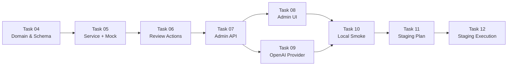

# 37 — FP-002 Engineering Design & Implementation Task Breakdown

> **Status**: 📋 DESIGN / PLANNING
>
> **Feature**: FP-002 — Scenario Generation Workflow
>
> **Prerequisites**: FP-002 Task 01 (Product Design), Task 02 (AI Contract Design)
>
> **Scope**: Engineering design + implementation task breakdown only.
> No backend/frontend/schema/API/runtime implementation.

---

## 1. Input Documents

| # | Doküman | Açıklama |
|---|---------|----------|
| 1 | [35-fp002-scenario-generation-workflow-product-design.md](./35-fp002-scenario-generation-workflow-product-design.md) | Product/workflow design |
| 2 | [36-fp002-ai-platform-contract-design.md](./36-fp002-ai-platform-contract-design.md) | AI platform contract design |
| 3 | [34-fp001-final-closure-operational-baseline.md](./34-fp001-final-closure-operational-baseline.md) | FP-001 closure & operational baseline |
| 4 | [18-content-pipeline-engineering.md](./18-content-pipeline-engineering.md) | FP-001 content pipeline engineering |

---

## 2. Engineering Objective

FP-002, FP-001'i zayıflatmadan senaryo generation workflow'unu ekler.

### Target Workflow

```
1. Sistem approved human-reviewed source draft'ı doğrular
2. Admin senaryo generation başlatır
3. AI gateway provider-agnostic senaryo content üretir
4. Backend senaryo candidate/version olarak saklar
5. Admin senaryo candidate'ı görüntüler
6. Admin senaryo candidate'ı düzenler
7. Admin explicit olarak approve veya reject eder
8. Approved senaryo source project ve draft'a izlenebilir kalır
```

### FP-001 Koruması

FP-002 implementasyonu sırasında:

- `ContentProjectStatus` enum değiştirilmez
- `ContentDraftStatus` enum değiştirilmez
- Mevcut API endpoints değiştirilmez
- Mevcut workflow transitions değiştirilmez
- `AiContentAgentGateway` interface dokunulmaz
- `MockAiContentAgentGateway` dokunulmaz
- FP-001 safety guarantees (18 madde) zayıflatılmaz

---

## 3. Domain Model Design Direction

### Entity Naming Evaluation

| Aday | Pro | Con | Uygunluk |
|------|-----|-----|----------|
| `ScenarioDraft` | Product "Scenario" + FP-001 "Draft" pattern tutarlılığı, reviewable candidate semantiği | Biraz uzun | ✅ **Önerilen** |
| `Scenario` | Kısa, ürün diliyle uyumlu | Approved ve candidate ayrımı belirsiz | ⚠️ İkincil |
| `ScenarioCandidate` | Candidate semantiği açık | FP-001 pattern'ıyla uyumsuz | ❌ |
| `GeneratedScenario` | AI üretim bağlamı | Review/edit sonrasını kapsamaz | ❌ |
| `ScriptDraft` | Domain model (02) referansı | FP-002 ürün dili "Scenario", karışıklık riski | ❌ |

### ✅ Önerilen: `ScenarioDraft`

**Gerekçe:**

1. **Product uyumu**: Ürün kavramı "Scenario" — entity adı bunu yansıtır
2. **FP-001 pattern**: `ContentDraft` pattern'ıyla tutarlı — "bir şeyin draft/candidate'ı"
3. **Semantik**: AI üretir → admin review/edit eder → approve/reject — bu "draft" semantiğidir
4. **İleride genişleme**: Approved scenario → storyboard/media input olabilir
5. **Karışıklık engeli**: `ContentDraft` (FP-001) vs `ScenarioDraft` (FP-002) açık ayrım
6. **Domain model (02) notu**: `ScriptDraft` 02'de planlanmıştı ama FP-002 ürün dili "Scenario". Entity adı proje evrimini yansıtmalı.

### Package Yapısı

```
com.anadoluatlasi.backend
├── content/                           ← FP-001 (dokunulmaz)
│   ├── entity/
│   │   ├── ContentProject.java
│   │   ├── ContentDraft.java
│   │   └── ...
│   ├── repository/
│   ├── controller/
│   └── dto/
├── scenario/                          ← FP-002 (yeni)
│   ├── entity/
│   │   ├── ScenarioDraft.java
│   │   ├── ScenarioBeat.java
│   │   ├── ScenarioDraftStatus.java
│   │   └── ScenarioBeatType.java
│   ├── repository/
│   │   └── ScenarioDraftRepository.java
│   ├── controller/
│   │   └── ScenarioDraftController.java
│   └── dto/
│       ├── ScenarioDraftResponse.java
│       ├── ScenarioBeatResponse.java
│       ├── UpdateScenarioDraftRequest.java
│       └── GenerateScenarioResponse.java
├── application/
│   ├── content/                       ← FP-001 (dokunulmaz)
│   │   └── ContentProjectService.java
│   └── scenario/                      ← FP-002 (yeni)
│       ├── ScenarioGenerationService.java
│       └── ScenarioReviewService.java
└── ai/
    ├── contract/                      ← FP-001 (dokunulmaz) + FP-002 (yeni)
    │   ├── ContentAgentRequest.java   ← dokunulmaz
    │   ├── ContentAgentResponse.java  ← dokunulmaz
    │   ├── ScenarioAgentRequest.java  ← yeni
    │   ├── ScenarioAgentResponse.java ← yeni
    │   └── ScenarioBeatResult.java    ← yeni
    ├── gateway/
    │   ├── AiContentAgentGateway.java ← dokunulmaz
    │   ├── AiScenarioAgentGateway.java ← yeni
    │   ├── ScenarioGatewayResult.java  ← yeni
    │   ├── mock/
    │   │   ├── MockAiContentAgentGateway.java ← dokunulmaz
    │   │   └── MockAiScenarioAgentGateway.java ← yeni
    │   └── openai/
    │       ├── OpenAiContentClient.java   ← dokunulmaz
    │       ├── OpenAiScenarioClient.java   ← yeni
    │       ├── OpenAiScenarioPromptBuilder.java ← yeni
    │       └── OpenAiScenarioResponseParser.java ← yeni
    └── config/
        └── AiGatewayConfig.java       ← genişletilir (scenario bean)
```

---

## 4. Scenario Lifecycle Engineering Direction

### Recommended Status Enum: `ScenarioDraftStatus`

```
AI_GENERATED → NEEDS_REVIEW → APPROVED
                             → REJECTED
FAILED
```

| Status | Açıklama | Kim tetikler | İzin verilen geçişler |
|--------|----------|-------------|----------------------|
| `AI_GENERATED` | AI tarafından üretildi | Sistem (gateway response) | → NEEDS_REVIEW |
| `NEEDS_REVIEW` | Admin incelemeye aldı | Admin | → APPROVED, → REJECTED |
| `APPROVED` | Admin onayladı | Admin (explicit POST) | Terminal |
| `REJECTED` | Admin reddetti | Admin (explicit POST) | Terminal |
| `FAILED` | AI üretimi başarısız | Sistem (gateway error) | Terminal |

### Engineering Kararları

| Karar | Tercih | Gerekçe |
|-------|--------|---------|
| `EDITED` ayrı status mı | ❌ Hayır | Metadata: editedAt, editedBy |
| `AI_GENERATED` ve `NEEDS_REVIEW` ayrı mı | ✅ Evet | Generate ve review başlangıcı ayrı adımlar |
| FAILED'dan retry | Yeni version oluştur | FAILED candidate tarihçede kalır |
| Generic status endpoint | ❌ Yasak | Explicit action endpoints |

> **Simplification notu**: Implementation sırasında `AI_GENERATED` ve
> `NEEDS_REVIEW` ayrımı gereksiz bulunursa tek status'e indirilebilir.
> Ancak generic status update endpoint asla eklenmeyecek.

---

## 5. Data Model Planning

### ScenarioDraft (Conceptual)

| Alan | Tip | Nullable | Açıklama |
|------|-----|----------|----------|
| `id` | UUID | ❌ | PK |
| `content_project_id` | UUID FK | ❌ | Bağlı Content Project |
| `source_draft_id` | UUID FK | ❌ | Kaynak approved draft |
| `version` | Integer | ❌ | Auto-increment per project |
| `status` | Enum | ❌ | ScenarioDraftStatus |
| `title` | VARCHAR(500) | ✅ | Senaryo başlığı |
| `summary` | TEXT | ✅ | Kısa özet |
| `target_audience` | VARCHAR(100) | ✅ | Hedef kitle |
| `cultural_objective` | TEXT | ✅ | Kültürel/öğretici amaç |
| `tone` | VARCHAR(100) | ✅ | Anlatım tonu |
| `estimated_duration_seconds` | Integer | ✅ | Tahmini video süresi |
| `setting` | VARCHAR(500) | ✅ | Mekan/lokasyon |
| `characters` | TEXT | ✅ | Karakterler |
| `review_notes` | TEXT | ✅ | Admin notları |
| `generated_by` | Enum | ❌ | AI_CONTENT_AGENT / HUMAN |
| `provider_type` | VARCHAR(50) | ✅ | Safe: "openai", "mock" |
| `model_name` | VARCHAR(100) | ✅ | Safe: "gpt-4o-mini" |
| `warnings_json` | TEXT | ✅ | AI uyarıları (JSON) |
| `created_at` | TIMESTAMP | ❌ | JPA auditing |
| `updated_at` | TIMESTAMP | ✅ | JPA auditing |
| `approved_at` | TIMESTAMP | ✅ | Onay zamanı |
| `rejected_at` | TIMESTAMP | ✅ | Red zamanı |
| `edited_at` | TIMESTAMP | ✅ | Son düzenleme |
| `created_by` | VARCHAR(100) | ✅ | Oluşturan admin |
| `approved_by` | VARCHAR(100) | ✅ | Onaylayan admin |
| `rejected_by` | VARCHAR(100) | ✅ | Reddeden admin |
| `edited_by` | VARCHAR(100) | ✅ | Düzenleyen admin |

### ScenarioBeat (Conceptual — Child Table)

| Alan | Tip | Nullable | Açıklama |
|------|-----|----------|----------|
| `id` | UUID | ❌ | PK |
| `scenario_draft_id` | UUID FK | ❌ | Parent reference |
| `type` | Enum | ❌ | ScenarioBeatType |
| `label` | VARCHAR(100) | ❌ | İnsan-okunur etiket |
| `body` | TEXT | ❌ | Beat içerik metni |
| `order_index` | Integer | ❌ | Sıralama (1-6) |
| `estimated_duration_seconds` | Integer | ✅ | Tahmini süre |

### Beat Persistence: Child Table (✅ Recommended)

| Seçenek | Pro | Con |
|---------|-----|-----|
| **Child table** | Bağımsız CRUD, beat bazlı query, temiz model | Bir tablo daha |
| Embedded JSON | Basit, tek tablo | Edit/query zor, migration riski |
| `@ElementCollection` | JPA native | Performance, cascade sorunları |

**Tavsiye**: Child table (`scenario_beats`). FP-001'de beat/scene yoktu,
bu yüzden yeni pattern. Child table daha temiz, beat bazlı edit/validation
mümkün.

### Approved Scenario Politikası

**Content Project başına max 1 APPROVED senaryo.**

Gerekçe: Downstream workflow (storyboard) tek bir approved senaryodan
devam eder. Yeni version approve edilirse eski approved auto-archive
**yapılmaz** — sadece business rule olarak yeni approve engellenebilir
veya eski approved tutulabilir. Bu karar implementation'da finalize
edilecek.

---

## 6. API Design Direction

### Endpoint Mapping

| Method | Endpoint | Açıklama |
|--------|----------|----------|
| `POST` | `/api/admin/content-projects/{projectId}/scenarios/generate` | Senaryo üret |
| `GET` | `/api/admin/content-projects/{projectId}/scenarios` | Senaryo listesi |
| `GET` | `/api/admin/scenarios/{scenarioId}` | Senaryo detay (beat'lerle) |
| `PUT` | `/api/admin/scenarios/{scenarioId}` | Senaryo düzenle |
| `POST` | `/api/admin/scenarios/{scenarioId}/start-review` | Review başlat |
| `POST` | `/api/admin/scenarios/{scenarioId}/approve` | Onayla |
| `POST` | `/api/admin/scenarios/{scenarioId}/reject` | Reddet |
| `POST` | `/api/admin/content-projects/{projectId}/scenarios/regenerate` | Yeniden üret |

### API Kuralları

| # | Kural |
|---|-------|
| 1 | Generic `PATCH status` yok |
| 2 | Generic status dropdown yok |
| 3 | REST DTO'ları provider-agnostic |
| 4 | Internal AI DTO'ları expose edilmez |
| 5 | Error mesajları sanitized |
| 6 | Controller'lar thin — logic service'te |
| 7 | FP-001 endpoint'leri dokunulmaz |

### REST DTO Design

```
GenerateScenarioResponse:
  success, scenarioDraftId, version, status, message

ScenarioDraftResponse:
  id, contentProjectId, sourceDraftId, version, status,
  title, summary, targetAudience, culturalObjective, tone,
  estimatedDurationSeconds, setting, characters, reviewNotes,
  beats[], generatedBy, createdAt, updatedAt, ...

ScenarioBeatResponse:
  id, type, label, body, orderIndex, estimatedDurationSeconds

UpdateScenarioDraftRequest:
  title, summary, targetAudience, tone, reviewNotes,
  beats[] { type, body, estimatedDurationSeconds }
```

---

## 7. Admin UI Design Direction

### UI Eklentileri

| # | Bileşen | Konum | Açıklama |
|---|---------|-------|----------|
| 1 | "Senaryo Üret" butonu | Content Project detay | Sadece approved draft varsa görünür |
| 2 | Senaryo version listesi | Content Project detay (alt bölüm) | Version, status, tarih, aksiyonlar |
| 3 | Senaryo detay sayfası | `/scenarios/{id}` | 6 beat görüntüleme |
| 4 | Beat edit formu | Senaryo detay | Inline edit, save |
| 5 | Approve/Reject butonları | Senaryo detay | Explicit action |
| 6 | Regenerate butonu | Content Project detay | Yeni version oluştur |
| 7 | Loading/error/success states | Tüm akış | Spinner, toast, error panel |

### UI Kuralları

- Status dropdown yok — sadece explicit action butonları
- Provider detayı user'a gösterilmez
- Beat'ler sıralı (1-6) gösterilir
- Edit sonrası auto-approve olmaz
- Approve/reject sonrası geri alınamaz (yeni version gerekir)

---

## 8. AI Gateway Implementation Direction

### Implementasyon Sırası

```
1. AiScenarioAgentGateway interface
2. ScenarioAgentRequest/Response/BeatResult contract'ları
3. ScenarioGatewayResult (success/failure)
4. MockAiScenarioAgentGateway — deterministic 6-beat output
5. AiGatewayConfig genişletme — scenario gateway bean
6. ScenarioGenerationService — mock integration
7. Backend tests — mock ile tam flow
8. OpenAiScenarioClient — real provider
9. OpenAiScenarioPromptBuilder — prompt construction
10. OpenAiScenarioResponseParser — JSON → ScenarioAgentResponse
11. Backend tests — OpenAI mapper tests (mocked HTTP)
```

### Kurallar

- Raw prompt commit edilmez
- Raw provider payload expose edilmez
- Model config-driven kalır
- Output validation gateway dışında, service layer'da
- FP-001 AI gateway'i dokunulmaz

---

## 9. Test Strategy

### Backend Domain/Service Tests

| # | Test | Expected Result |
|---|------|-----------------|
| 1 | Approved draft'tan senaryo generation | ✅ Candidate oluşur |
| 2 | Unapproved draft'tan generation | ❌ Reddedilir |
| 3 | Missing draft'tan generation | ❌ Hata |
| 4 | Mock provider başarılı response | ✅ 6-beat candidate oluşur |
| 5 | Provider failure → FAILED candidate | ✅ Error mapping |
| 6 | Regeneration → yeni version | ✅ Version increment |
| 7 | Approved scenario overwrite edilmez | ✅ Korunur |
| 8 | Approve = explicit admin action | ✅ Status = APPROVED |
| 9 | Reject = explicit admin action | ✅ Status = REJECTED |
| 10 | AI üretimi APPROVED oluşturmaz | ✅ AI_GENERATED only |
| 11 | Generic status transition yok | ✅ Endpoint yok |
| 12 | Beat validation (6 zorunlu) | ✅ Eksik beat → hata |

### API/Controller Tests

| # | Test |
|---|------|
| 1 | Generate endpoint → success |
| 2 | Generate endpoint → prerequisite failure |
| 3 | List scenarios per project |
| 4 | Get scenario detail with beats |
| 5 | Edit scenario beats |
| 6 | Approve endpoint → APPROVED |
| 7 | Reject endpoint → REJECTED |
| 8 | Sanitized error response (no provider leak) |

### AI Gateway Tests

| # | Test |
|---|------|
| 1 | Mock provider deterministic 6-beat output |
| 2 | Mock provider failure scenarios |
| 3 | OpenAI mapper: valid JSON → ScenarioAgentResponse |
| 4 | OpenAI mapper: invalid/empty output → error |
| 5 | OpenAI mapper: auth/rate-limit/timeout mapping |
| 6 | Output validation: missing beats → INVALID_FORMAT |

### Frontend / Manual QA

| # | Test |
|---|------|
| 1 | Generate button visibility (approved draft only) |
| 2 | Scenario version list |
| 3 | Scenario detail with 6 beats |
| 4 | Beat edit + save |
| 5 | Approve → status badge update |
| 6 | Reject → status badge update |
| 7 | Regenerate → new version appears |
| 8 | Error state display |
| 9 | Loading state display |

---

## 10. Implementation Task Breakdown

### Task Sequence



---

### Task 04 — Backend Domain & Schema

**Scope**: Entity, enum, migration, repository. No AI call.

| Deliverable | Detay |
|-------------|-------|
| `ScenarioDraft` entity | JPA entity, Lombok, auditing |
| `ScenarioBeat` entity | Child table, `@ManyToOne` |
| `ScenarioDraftStatus` enum | AI_GENERATED, NEEDS_REVIEW, APPROVED, REJECTED, FAILED |
| `ScenarioBeatType` enum | HOOK, INTRODUCTION, MAIN_NARRATIVE, EMOTIONAL_CLIMAX, CONCLUSION, CALL_TO_ACTION |
| Flyway migration | `V*__create_scenario_tables.sql` |
| `ScenarioDraftRepository` | Spring Data JPA |
| `ScenarioBeatRepository` | Spring Data JPA (if needed) |
| Tests | Entity instantiation, repository save/find |

**Kurallar**: FP-001 entity'lerine dokunma. Raw payload/secret field'ı yok.

---

### Task 05 — Backend Scenario Service with Mock Generation

**Scope**: Generation service, approved draft validation, mock gateway.

| Deliverable | Detay |
|-------------|-------|
| `AiScenarioAgentGateway` interface | `generateScenario(ScenarioAgentRequest)` |
| `ScenarioGatewayResult` | success/failure wrapper |
| `ScenarioAgentRequest` | Provider-agnostic request contract |
| `ScenarioAgentResponse` | Provider-agnostic response contract |
| `ScenarioBeatResult` | Beat result DTO |
| `MockAiScenarioAgentGateway` | Deterministic 6-beat output + failure modes |
| `ScenarioGenerationService` | Prerequisite validation, gateway call, persist |
| `AiGatewayConfig` update | Scenario gateway bean registration |
| Tests | Mock generation, prerequisite checks, version tracking |

**Kurallar**: Source draft approved kontrolü. AI → AI_GENERATED only, never APPROVED.

---

### Task 06 — Scenario Review Actions Backend

**Scope**: Edit, approve, reject actions. Explicit endpoints only.

| Deliverable | Detay |
|-------------|-------|
| `ScenarioReviewService` | startReview, approve, reject, edit methods |
| Edit logic | Beat update, editedAt/editedBy metadata |
| Approve logic | assertStatus, set APPROVED, approvedAt/approvedBy |
| Reject logic | assertStatus, set REJECTED, rejectedAt/rejectedBy |
| Regeneration | Yeni version oluştur, mevcut dokunma |
| Tests | Status transitions, approved scenario koruması, explicit action |

**Kurallar**: Generic status update yok. Approved scenario overwrite yok.

---

### Task 07 — Admin API Endpoints

**Scope**: REST controllers, DTOs, thin controller pattern.

| Deliverable | Detay |
|-------------|-------|
| `ScenarioDraftController` | Thin controller, tüm logic service'te |
| Generate endpoint | `POST .../scenarios/generate` |
| List endpoint | `GET .../scenarios` |
| Detail endpoint | `GET /api/admin/scenarios/{id}` |
| Edit endpoint | `PUT /api/admin/scenarios/{id}` |
| Start-review endpoint | `POST .../start-review` |
| Approve endpoint | `POST .../approve` |
| Reject endpoint | `POST .../reject` |
| Regenerate endpoint | `POST .../scenarios/regenerate` |
| DTOs | Provider-agnostic, internal AI DTO expose etmez |
| Tests | Controller tests, error response sanitization |

---

### Task 08 — Admin UI Scenario Workflow

**Scope**: React components, API integration, UX flow.

| Deliverable | Detay |
|-------------|-------|
| Scenario API client | scenarioApi.ts |
| Generate button | Content Project detay → approved draft varsa |
| Scenario version list | Content Project detay alt bölüm |
| Scenario detail page | 6-beat görüntüleme |
| Beat edit form | Inline edit, save |
| Approve/reject buttons | Explicit action |
| Regenerate button | Yeni version |
| Loading/error states | Spinner, toast, error panel |
| Build test | `npm run build` pass |

---

### Task 09 — OpenAI Scenario Provider

**Scope**: Real OpenAI implementation behind gateway.

| Deliverable | Detay |
|-------------|-------|
| `OpenAiScenarioClient` | HTTP call to OpenAI |
| `OpenAiScenarioPromptBuilder` | Request → prompt mapping |
| `OpenAiScenarioResponseParser` | JSON → ScenarioAgentResponse |
| Output validation | 6-beat, non-empty body, title check |
| Error mapping | AiErrorType reuse |
| Tests | Mocked HTTP client, parser tests |

**Kurallar**: Raw prompt commit edilmez. Raw payload expose edilmez.

---

### Task 10 — Local Smoke Test

**Scope**: Full workflow validation (mock + optional real).

| Deliverable | Detay |
|-------------|-------|
| Mock provider smoke | KI → CP → Draft → Approve → Generate Scenario → Review → Approve |
| Real provider smoke | Opsiyonel (AI_PROVIDER=openai ile) |
| Log safety check | Key/prompt leak yok |
| Smoke test dokümanı | Adım adım sonuçlar |

---

### Task 11 — Staging Execution Plan

**Scope**: Deployment checklist, rollback plan.

| Deliverable | Detay |
|-------------|-------|
| Deployment checklist | Image build, migration, env vars |
| Config validation | AI_PROVIDER, model, yeni DB table |
| Rollback plan | Mock'a dönüş, migration rollback |
| Smoke test script | Staging curl komutları |

---

### Task 12 — Staging Execution Report

**Scope**: Staging'de full workflow execution.

| Deliverable | Detay |
|-------------|-------|
| Full workflow execution | Generate → Review → Edit → Approve |
| Secret/log safety | Key leak check |
| Provider verification | Real OpenAI generation |
| Error handling check | Provider failure simulation |
| Report | Sonuçlar, başarı/başarısızlık |

---

## 11. Risk Review

| # | Risk | Mitigation |
|---|------|-----------|
| 1 | ContentDraft vs ScenarioDraft karışıklığı | Farklı package: `content/` vs `scenario/` |
| 2 | Internal AI DTO expose | DTO/entity ayrımı, controller'da response mapping |
| 3 | Raw provider payload expose | Response DTO'da sadece safe fields |
| 4 | Unapproved draft'tan generation | Service'te prerequisite validation |
| 5 | Otomatik approval | AI → AI_GENERATED only, approve = explicit POST |
| 6 | Generic status endpoint | Explicit action endpoints, no PATCH status |
| 7 | Approved scenario overwrite | Regeneration = yeni version, approved dokunulmaz |
| 8 | OpenAI invalid output | Output validation + INVALID_FORMAT error mapping |
| 9 | Cost/rate-limit | Config-driven model, rate limit error handling |
| 10 | Scope creep (storyboard/media) | Non-goals listesi, task scope sınırları |
| 11 | FP-001 regression | FP-001 code dokunulmaz, mevcut testler korunur |

---

## 12. Open Decisions for Implementation

| # | Karar | Tavsiye | Ne Zaman |
|---|-------|---------|----------|
| 1 | Entity adı | `ScenarioDraft` | ✅ Bu dokümanda |
| 2 | Beat persistence | Child table (`scenario_beats`) | ✅ Bu dokümanda |
| 3 | Max 1 approved per project | Evet — business rule | Task 06'da finalize |
| 4 | `NEEDS_REVIEW` gerekli mi | Evet — generate ve review ayrımı | Task 04'te finalize |
| 5 | Source draft approval check | ContentProject.status == APPROVED | Task 05'te finalize |
| 6 | AiErrorType reuse | Evet — mevcut enum yeterli | Task 05'te finalize |
| 7 | Admin route structure | `/scenarios/{id}` ayrı sayfa | Task 08'de finalize |

---

## 13. Non-Goals

| # | Non-Goal |
|---|----------|
| 1 | Storyboard implementation |
| 2 | Image/video/audio generation |
| 3 | Public publishing |
| 4 | Prompt management UI |
| 5 | Cost dashboard |
| 6 | Multi-provider UI |
| 7 | Bulk scenario generation |
| 8 | Production provider switching |
| 9 | Stack naming cleanup |
| 10 | Domain model (02) rename/update |

---

## 14. Acceptance Criteria

| # | Kriter | Durum |
|---|--------|-------|
| 1 | FP-002 Task 03 engineering design/task breakdown document oluşturuldu | ✅ |
| 2 | Backend/frontend/schema/API/runtime implementation yok | ✅ |
| 3 | Domain model direction belgelendi (ScenarioDraft) | ✅ |
| 4 | Gateway direction belgelendi (AiScenarioAgentGateway) | ✅ |
| 5 | API direction implementation olmadan belgelendi | ✅ |
| 6 | Admin UI direction implementation olmadan belgelendi | ✅ |
| 7 | Test strategy belgelendi | ✅ |
| 8 | Implementation task'ları küçük reviewable parçalara ayrıldı (9 task) | ✅ |
| 9 | FP-001 ve FP-002 governance kuralları korundu | ✅ |
| 10 | Scope creep açıkça engellendi | ✅ |

---

## Referanslar

| Doküman | Açıklama |
|---------|----------|
| [35-fp002-scenario-generation-workflow-product-design.md](./35-fp002-scenario-generation-workflow-product-design.md) | Task 01 — Product Design |
| [36-fp002-ai-platform-contract-design.md](./36-fp002-ai-platform-contract-design.md) | Task 02 — AI Contract Design |
| [34-fp001-final-closure-operational-baseline.md](./34-fp001-final-closure-operational-baseline.md) | FP-001 Closure |
| [18-content-pipeline-engineering.md](./18-content-pipeline-engineering.md) | FP-001 Engineering |
