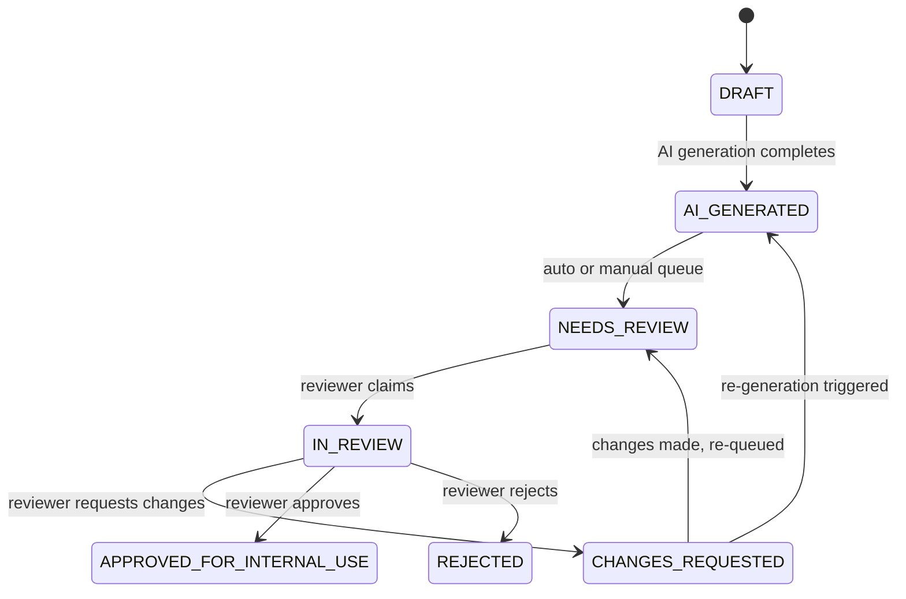

# FP-012 — Admin Review Console & Human Approval Workflow Hardening — Combined Design

## 1. Document Status

| Field | Value |
|-------|-------|
| **Feature** | FP-012 — Admin Review Console & Human Approval Workflow Hardening |
| **Document Type** | Combined Product / AI Platform / Engineering Design |
| **Status** | PLANNED |
| **Source Baseline** | FP-011 closure: [76-fp011-final-closure-operational-baseline.md](76-fp011-final-closure-operational-baseline.md) |
| **FP-011 Final Test Baseline** | 1599/1599 passing |
| **Created** | 2026-07-05 |

> This is a **planning document only**. No code, tests, migrations, or endpoints are changed.

---

## 2. Previous Feature Baseline

### FP-011 Final State

- Runtime config validation exists (RuntimeStorageConfigValidator)
- Internal readiness check exists (InternalStorageReadinessService)
- Observability/alerting hardening exists
- Production rollout runbook exists
- All runtime storage flags disabled by default
- Provider download, private storage, immediate handoff remain config-gated
- Provider URLs remain transient backend-only execution data
- Storage keys remain internal — not admin/user-facing
- Preview remains backend-controlled
- Human review gate preserved — AI output is never automatically approved
- No public/signed URL delivery
- No publish/export
- No video/audio

### Closed Feature Chain

| # | Feature | Status |
|---|---------|--------|
| FP-001 | AI Assisted Content Creation | CLOSED |
| FP-002 | Scenario Generation Workflow | CLOSED |
| FP-003 | Storyboard Workflow | CLOSED |
| FP-004 | Multi-Platform Content Packaging | CLOSED |
| FP-005 | Content Export & Production Handoff | CLOSED |
| FP-006 | Visual Asset Planning & Image Generation Handoff | CLOSED |
| FP-007 | Image Generation & Media Asset Pipeline | CLOSED |
| FP-008 | Safe Storage Handoff & Preview Proxy | CLOSED |
| FP-009 | Provider Output Retrieval & Real Storage Provider Integration | CLOSED |
| FP-010 | Real Storage Activation & Production Storage Operations | CLOSED |
| FP-011 | Production Storage Enablement & Runtime Operations | CLOSED |

---

## 3. FP-012 Purpose

FP-012 hardens the admin/human review workflow **before** any publishing, exporting, public delivery, or user-facing media library feature is introduced.

The feature ensures:
- Every AI-generated output requires explicit human review and approval
- Review states are well-defined and prevent accidental status leakage
- Rejection/revision loops are safe and auditable
- Admin preview remains backend-controlled and secret-free
- The governance gate is hardened so future publish/export features inherit safe defaults

FP-012 does **not** implement publish, export, public delivery, or user-facing media access.

---

## 4. Product Value

| # | Value |
|---|-------|
| 1 | **Governance assurance** — every AI output passes human review before any downstream action |
| 2 | **Content quality** — reviewers can request changes, reject, or approve with clear semantics |
| 3 | **Audit readiness** — all review actions are traceable with reviewer identity, timestamps, and notes |
| 4 | **Operational safety** — forbidden status transitions are enforced, preventing accidental publish/export |
| 5 | **Safe preview** — reviewers see content through backend-controlled proxy, never via direct URLs |
| 6 | **Foundation for future features** — publish/export/public delivery can safely build on hardened review gate |
| 7 | **Team coordination** — multiple reviewers can collaborate with clear review states |

---

## 5. User Roles & Review Responsibilities

### Conceptual Roles

| Role | Responsibility |
|------|---------------|
| **Content Creator** | Initiates project, triggers AI generation, reviews own drafts informally |
| **Content Reviewer** | Reviews AI-generated outputs, requests changes, approves for internal use |
| **Admin** | Manages review assignments, monitors review pipeline, enforces policy |

### Role Boundaries

- Content Creator cannot self-approve AI-generated outputs for internal use
- Content Reviewer approval is internal-only — not publish/export approval
- Admin does not bypass review gate
- No role can automatically approve AI output
- No role can transition content to PUBLISHED/EXPORTED/READY_FOR_PUBLISH/COMPLETED

> **Note:** Role implementation (RBAC, auth) is a follow-up concern. FP-012 focuses on review workflow semantics. Initial implementation may use a single "admin" role.

---

## 6. Review Workflow States & Allowed Transitions

### Proposed Review States

| State | Description |
|-------|-------------|
| `DRAFT` | Content project created, no AI generation yet |
| `AI_GENERATED` | AI output produced — awaiting human review |
| `NEEDS_REVIEW` | Explicitly queued for reviewer attention |
| `IN_REVIEW` | Reviewer has claimed/started review |
| `CHANGES_REQUESTED` | Reviewer requested modifications |
| `APPROVED_FOR_INTERNAL_USE` | Reviewer approved — for internal use only |
| `REJECTED` | Reviewer rejected — terminal for this version |

### Allowed Transitions

### Forbidden Transitions

| From | To | Reason |
|------|----|--------|
| Any | READY_FOR_PUBLISH | Does not exist — future feature |
| Any | COMPLETED | Does not exist — future feature |
| Any | PUBLISHED | Does not exist — future feature |
| Any | EXPORTED | Does not exist — future feature |
| AI_GENERATED | APPROVED_FOR_INTERNAL_USE | Must go through NEEDS_REVIEW → IN_REVIEW first |
| DRAFT | APPROVED_FOR_INTERNAL_USE | Must have AI output and review |
| REJECTED | APPROVED_FOR_INTERNAL_USE | Must re-generate or revise first |

### Critical Rules

- `APPROVED_FOR_INTERNAL_USE` is **NOT** publish approval
- Internal approval does **NOT** create a public URL
- Internal approval does **NOT** create a signed URL
- Internal approval does **NOT** export files
- Internal approval does **NOT** publish content
- Internal approval does **NOT** bypass future separate publish/export gates
- Automatic transition to APPROVED_FOR_INTERNAL_USE is **forbidden**

---

## 7. Admin Review Console Scope

### In Scope (design only)

The admin review console is planned to display:

| Category | Content |
|----------|---------|
| Project summary | Title, topic, niche, language, creation date |
| Generation state | Scenario, storyboard, visual asset plan, image generation status |
| Review status | Current review state, reviewer identity, timestamps |
| Safe preview | Backend-proxied content preview (no direct URLs) |
| Review notes | Reviewer comments, change requests, rejection reasons |
| Revision history | Version tracking, re-generation history |
| Audit trail | Who reviewed, when, what action, safe notes |

### Out of Scope (console must NOT expose)

| Category | Reason |
|----------|--------|
| Provider URLs | Transient backend-only data |
| Storage keys / object keys | Internal-only |
| Bucket names / paths | Internal infrastructure |
| Raw provider payloads | Internal AI platform data |
| Raw storage payloads | Internal storage data |
| Secrets / API keys | Never exposed |
| Internal config values | Internal operational data |
| Stack traces | Internal debug data |
| Base64 content | Raw binary — use preview proxy |
| Publish/export controls | Future feature |
| Public URL generation | Future feature |
| Signed URL delivery | Future feature |

---

## 8. AI Output Review Requirements

### Reviewable AI Outputs

| Output Type | Source Feature | Review Scope |
|-------------|---------------|-------------|
| Research notes | FP-001 | Text content, source quality |
| Scenario/script | FP-002 | Narrative structure, beat quality |
| Storyboard | FP-003 | Scene descriptions, visual direction |
| Platform packages | FP-004 | SEO, titles, descriptions |
| Visual asset plans | FP-006 | Prompt quality, style direction |
| Generated images | FP-007 | Visual quality, appropriateness |

### AI Output Representation for Review

- ✅ Normalized text outputs only
- ✅ Safe preview references (backend-proxied images)
- ✅ Generation metadata: provider alias, model alias, timestamp
- ❌ No raw provider payload
- ❌ No provider execution metadata beyond safe aliases
- ❌ No provider URL exposure
- ❌ No automatic approval
- ❌ No publish/export status

---

## 9. Human Approval Guardrails

| # | Guardrail |
|---|-----------|
| 1 | AI output is **never** automatically approved — explicit human action required |
| 2 | Approval requires the content to be in `IN_REVIEW` state |
| 3 | Approval transitions to `APPROVED_FOR_INTERNAL_USE` only |
| 4 | `APPROVED_FOR_INTERNAL_USE` does not imply publish/export readiness |
| 5 | No bulk auto-approve capability |
| 6 | Approval must record reviewer identity and timestamp |
| 7 | Approval must record optional review notes |
| 8 | Approved content remains internal until a future separate publish/export gate |
| 9 | Approval cannot be reversed to a lower state except through explicit rejection/revision |
| 10 | Self-approval (creator = reviewer) is configurable but discouraged by default |

---

## 10. Rejection / Revision Workflow

### Rejection

- Reviewer sets state to `REJECTED` with mandatory rejection reason
- Rejection is terminal for the current version
- Content can be revised (new version) or re-generated (new AI run)
- Rejection reason is safe text — no provider URLs/storage keys/secrets

### Revision (Changes Requested)

- Reviewer sets state to `CHANGES_REQUESTED` with change request notes
- Content creator addresses changes
- Content is re-queued as `NEEDS_REVIEW` when ready
- Change request notes are safe text — no provider URLs/storage keys/secrets

### Revision Rules

- Re-generation creates a new AI version, preserving history
- Previous versions remain accessible for comparison
- Version tracking links generations to review actions
- No version deletion — audit trail must be complete

---

## 11. Audit & Traceability Requirements

### Required Audit Fields

| Field | Purpose |
|-------|---------|
| Action type | APPROVE, REJECT, REQUEST_CHANGES, CLAIM_REVIEW, RELEASE_REVIEW |
| Reviewer identity | Who performed the action |
| Timestamp | When the action occurred |
| Previous state | State before the action |
| New state | State after the action |
| Review notes | Safe text (no secrets/URLs/keys) |
| Content version | Which version was reviewed |
| Project reference | Which project this review belongs to |

### Audit Safety

- ✅ Audit records contain only safe categories and text
- ❌ No provider URLs in audit
- ❌ No storage keys in audit
- ❌ No secrets/API keys in audit
- ❌ No raw payloads in audit
- ❌ No base64 content in audit
- ❌ No stack traces in audit

---

## 12. Safe Preview Requirements

### Preview Behavior

- Preview uses existing backend-controlled proxy (FP-008/FP-010)
- Preview streams bytes through backend — never redirects to storage/provider URL
- Preview requires authentication (admin/reviewer role)
- Preview does not expose storage key, bucket, or provider URL

### Preview Scope for Review

| Content Type | Preview Method |
|-------------|---------------|
| Text content | Rendered in review console |
| Generated images | Backend-proxied image preview |
| Scenario/storyboard | Text rendering with beat/scene structure |
| Platform packages | Text rendering with metadata |

### Preview Safety

- ✅ Backend-controlled streaming
- ❌ No public URL
- ❌ No signed URL
- ❌ No CDN URL
- ❌ No redirect to storage
- ❌ No storage key in preview response headers
- ❌ No provider URL in preview response

---

## 13. API / Backend Design Direction

### Planned API Surface (design only — not implemented in Task 01)

| Endpoint Concept | Method | Purpose |
|-----------------|--------|---------|
| List reviewable items | GET | List content in NEEDS_REVIEW / IN_REVIEW |
| Get review detail | GET | Get content summary + safe preview refs |
| Claim review | POST | Transition NEEDS_REVIEW → IN_REVIEW |
| Approve | POST | Transition IN_REVIEW → APPROVED_FOR_INTERNAL_USE |
| Reject | POST | Transition IN_REVIEW → REJECTED (with reason) |
| Request changes | POST | Transition IN_REVIEW → CHANGES_REQUESTED (with notes) |
| Get audit trail | GET | Get review action history for a project |

### API Safety Rules

- All endpoints require admin/reviewer authentication
- No endpoint returns provider URLs, storage keys, secrets, or raw payloads
- Preview is always backend-proxied, never a redirect
- State transition endpoints enforce allowed transitions only
- Forbidden transitions return safe error response
- No generic status update endpoint — each action has its own endpoint

---

## 14. Data Model Design Direction

### Conceptual Entities (design only — not implemented in Task 01)

| Entity | Purpose |
|--------|---------|
| `ReviewState` | Current review state for a content project or asset |
| `ReviewAction` | Audit record of a review action |
| `ReviewNote` | Safe text note attached to a review action |

### ReviewState Fields (conceptual)

| Field | Type | Safe |
|-------|------|------|
| id | UUID | ✅ |
| project_id | UUID | ✅ |
| current_state | Enum | ✅ |
| reviewer_id | UUID | ✅ |
| claimed_at | Timestamp | ✅ |
| approved_at | Timestamp | ✅ |
| rejected_at | Timestamp | ✅ |
| version | Integer | ✅ |

### Forbidden Data Model Fields

| Field | Reason |
|-------|--------|
| provider_url | Transient — never persisted |
| storage_key / object_key | Internal-only |
| base64_content | Raw binary — use preview |
| raw_provider_payload | Internal AI data |
| access_key / secret_key / token | Credential |

---

## 15. Security & Privacy Boundaries

### FP-012 Will NOT Introduce

| # | Constraint |
|---|-----------|
| 1 | No public URL generation |
| 2 | No signed URL generation |
| 3 | No CDN delivery |
| 4 | No public media delivery |
| 5 | No publish/export |
| 6 | No user-facing media library |
| 7 | No video/audio |
| 8 | No automatic approval |
| 9 | No READY_FOR_PUBLISH status |
| 10 | No COMPLETED status |
| 11 | No PUBLISHED status |
| 12 | No EXPORTED status |
| 13 | No generic status update endpoint |
| 14 | No provider URL exposure/persistence/logging |
| 15 | No storage key exposure/logging |
| 16 | No bucket/path sensitive exposure |
| 17 | No raw provider/storage payload exposure |
| 18 | No base64 DB/DTO/log/API response |
| 19 | No secret/API key/config exposure |
| 20 | No public config inspection endpoint |
| 21 | No admin/user readiness endpoint |
| 22 | No production credential changes |
| 23 | No migration/schema changes in Task 01 |
| 24 | No broad refactor |

---

## 16. Observability & Operational Signals

### Safe Observability Concepts for Review Workflow

| Signal | Safe Labels |
|--------|-------------|
| Review action count | action_type, project_id, reviewer_alias |
| Review state transition count | from_state, to_state |
| Review latency | claim → approve/reject duration |
| Rejected item count | rejection_category |
| Changes requested count | project_id |
| Forbidden transition attempts | from_state, attempted_to_state |

### Forbidden Observability Labels

| Label | Reason |
|-------|--------|
| provider_url | Transient — never logged/metriced |
| storage_key | Internal-only |
| reviewer_password / token | Credential |
| raw_review_content | May contain sensitive text |
| base64 | Raw binary |

---

## 17. Explicit Non-Goals

The following are explicitly **out of scope** for FP-012:

- ❌ Publish workflow
- ❌ Export workflow
- ❌ Public media delivery / CDN
- ❌ Signed URL delivery
- ❌ User-facing media library
- ❌ Video/audio pipeline
- ❌ RBAC / role management implementation (use single admin role initially)
- ❌ Frontend implementation (design only in this task)
- ❌ Real-time notifications / WebSocket
- ❌ Multi-tenant review isolation
- ❌ External reviewer integration
- ❌ Automatic content moderation / AI-based review
- ❌ READY_FOR_PUBLISH / COMPLETED / PUBLISHED / EXPORTED statuses

---

## 18. Task Sequence Proposal

| Task | Title | Scope |
|------|-------|-------|
| Task 01 | Combined Product / AI Platform / Engineering Design | This document |
| Task 02 | Review State Model & Transition Validation | Entity/enum for review states, forbidden transition enforcement, tests |
| Task 03 | Review Action Service & Audit Trail | Service for approve/reject/request-changes, audit record model, tests |
| Task 04 | Admin Review DTO & Safe Response Design | Safe DTO for review list/detail, forbidden field tests, tests |
| Task 05 | Admin Review API Endpoints | REST endpoints for list/claim/approve/reject/request-changes, tests |
| Task 06 | Review Workflow Integration Tests & Safety Regression | End-to-end workflow tests, forbidden transition tests, safety sweep |
| Task 07 | Regression Tests & Closure Candidate | Final regression, closure candidate doc |
| Task 08 | Final Closure / Operational Baseline | Closure document, test baseline |

---

## 19. Acceptance Criteria

| # | Criterion | Status |
|---|----------|--------|
| 1 | FP-012 combined design doc exists | ✅ |
| 2 | Document references FP-011 final closure baseline | ✅ |
| 3 | Document clearly defines FP-012 scope | ✅ |
| 4 | Document clearly defines out-of-scope items | ✅ |
| 5 | Document proposes safe review workflow (7 states) | ✅ |
| 6 | Document preserves human review gate | ✅ |
| 7 | Document states AI output is never automatically approved | ✅ |
| 8 | Document states internal approval ≠ publish/export | ✅ |
| 9 | Document states no public/signed URL delivery | ✅ |
| 10 | Document states provider URLs/storage keys/secrets remain hidden | ✅ |
| 11 | Document proposes follow-up task sequence (8 tasks) | ✅ |
| 12 | Documentation-only task | ✅ |
| 13 | No production code changes | ✅ |
| 14 | No tests added | ✅ |
| 15 | No migration/schema changes | ✅ |
| 16 | No endpoint expansion | ✅ |

---

## 20. Next Step

**Next step:** FP-012 Task 02 — Review State Model & Transition Validation

Only after Task 01 is accepted.
