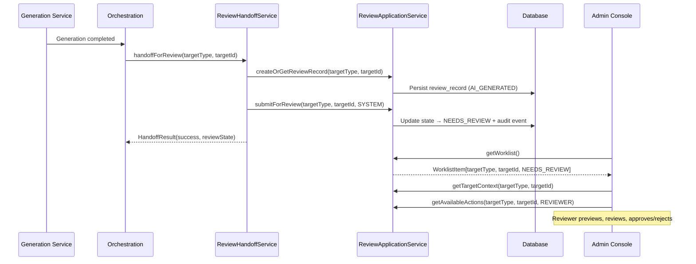
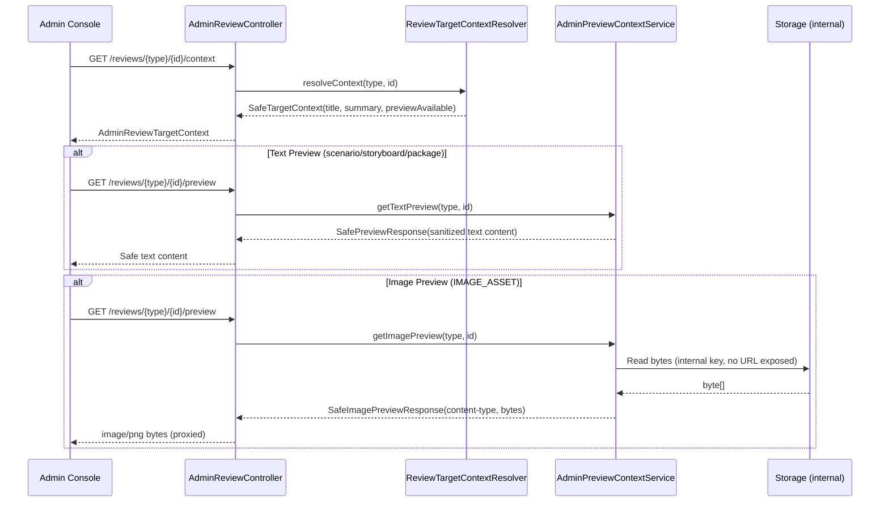
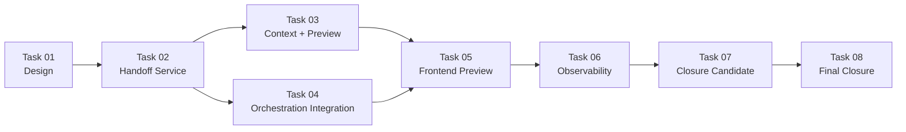

# FP-013 — Review-Gated Orchestration Integration & Admin Preview Workflow — Combined Design

**Document Status:** FP-013 DESIGN — Task 01
**Feature:** FP-013 — Review-Gated Orchestration Integration & Admin Preview Workflow
**Date:** 2026-07-06
**Previous Feature Baseline:** [FP-012 Final Closure](83-fp012-final-closure-operational-baseline.md)

---

## 1. Previous Feature Baseline

FP-012 delivered a safe internal admin review console and human approval workflow:

- **31 backend production files** — review state machine, domain/application services, persistence, safe DTOs, admin controller
- **4 frontend production files** — types, API client, review console, worklist
- **1 migration** — V10 review workflow tables (review_records, review_audit_events)
- **12 API endpoints** — 7 POST action + 5 GET query/availability
- **7 review states** — DRAFT, AI_GENERATED, NEEDS_REVIEW, IN_REVIEW, CHANGES_REQUESTED, APPROVED_FOR_INTERNAL_USE, REJECTED
- **7 review actions** — SUBMIT_FOR_REVIEW, START_REVIEW, REQUEST_CHANGES, APPROVE_FOR_INTERNAL_USE, REJECT, RETURN_TO_DRAFT, ADD_REVIEW_NOTE
- **4 actor roles** — CREATOR, REVIEWER, ADMIN, SYSTEM
- **Backend tests:** 1941/1941 passing
- **Frontend tests:** 209/209 passing

FP-012 safety baseline carried forward:

- APPROVED_FOR_INTERNAL_USE is internal only — does not publish, export, create public URL, or create signed URL
- Human review gate preserved
- AI_GENERATED does not imply approval
- CREATOR/SYSTEM cannot approve
- actorRole is not authentication
- No generic status update, publish/export, CDN, provider/storage inspection, unsafe HTML, stack trace/secret exposure

## 2. FP-013 Purpose

FP-013 connects generated content and assets into the FP-012 review workflow and admin preview flow. After FP-013:

- Every generated reviewable output has a review record.
- Generated outputs enter the review queue automatically as NEEDS_REVIEW.
- Admin reviewers see generated outputs in the worklist with safe context.
- Admin preview displays normalized content without exposing provider URLs, storage keys, or raw payloads.
- Human approval remains explicit.
- No publish/export/public delivery is introduced.

## 3. Product Value

| Value | Description |
|-------|-------------|
| **Reviewable pipeline** | AI-generated content is no longer invisible — every output is queued for human review |
| **Quality gate** | Nothing reaches internal approval without explicit human action |
| **Admin visibility** | Reviewers see what was generated, when, and can preview safely |
| **Audit trail** | Generation-to-review handoff is logged and traceable |
| **Future-ready** | Publish/export workflows can build on approved internal assets in future features |

## 4. End-to-End Workflow Target

```
┌─────────────────────────────────────────────────────────────────────┐
│  1. AI Generation completes (scenario/storyboard/package/image)    │
│  2. Generated output is persisted (existing feature baselines)     │
│  3. Orchestration calls ReviewHandoffService                       │
│  4. ReviewHandoffService creates/updates review record             │
│     → State: AI_GENERATED → SUBMIT_FOR_REVIEW → NEEDS_REVIEW      │
│  5. Admin worklist shows the target                                │
│  6. Admin opens target context → safe preview                      │
│  7. Reviewer acts: request changes / reject / approve internal     │
│  8. APPROVED_FOR_INTERNAL_USE = internal only                      │
│  9. No publish/export/public delivery                              │
└─────────────────────────────────────────────────────────────────────┘
```

### Sequence Diagram



## 5. Review-Gated Orchestration Concept

### Principles

1. **Generation success ≠ approval.** A successful AI generation only means the output is ready for review.
2. **Orchestration creates review records, not approvals.** The orchestration layer is responsible for ensuring every reviewable output has a review record in NEEDS_REVIEW state.
3. **Human review is the gate.** No generated output reaches APPROVED_FOR_INTERNAL_USE without explicit human action.
4. **Idempotent handoff.** Calling handoff twice for the same target is safe — it does not create duplicates or overwrite existing review state.
5. **Failure is safe.** If review handoff fails, the generated output remains persisted but not queued for review. No data loss, no publish, no export.

### Orchestration Boundary

```
Orchestration Layer
├── Calls ReviewHandoffService after generation success
├── Does NOT approve anything
├── Does NOT publish/export
├── Does NOT create public/signed URLs
├── Does NOT expose provider URLs or storage keys
└── Logs handoff result with safe error codes only
```

## 6. Review Target Mapping Strategy

### Target Type Mapping

| Generated Artifact | ReviewTargetType | Target ID Source | Safe Display Title Source | Safe Context Summary Source |
|---|---|---|---|---|
| Content project | CONTENT_PROJECT | project.id | project.title (sanitized) | project.topic + niche |
| Scenario draft | SCENARIO | scenarioDraft.id | "Senaryo: " + project.title | Beat count + duration summary |
| Storyboard draft | STORYBOARD | storyboardDraft.id | "Storyboard: " + project.title | Scene count + duration summary |
| Multi-platform package | PACKAGE | platformPackage.id | "Paket: " + platform + project.title | Platform + format summary |
| Image generation asset | IMAGE_ASSET | generatedAsset.id / mediaAsset.id | "Görsel: " + scene label or thumbnail label | Aspect ratio + style + status |

### Per-Target Configuration

#### CONTENT_PROJECT

| Property | Value |
|----------|-------|
| Target ID source | `project.id` (UUID) |
| Safe display title | `ReviewTextSafety.sanitize(project.title)` |
| Safe context summary | topic + niche + language (sanitized) |
| Preview availability | Text-based — always available |
| Review creation trigger | Project creation or first AI generation |
| Expected initial review state | DRAFT (created by user) or AI_GENERATED → NEEDS_REVIEW (after generation) |
| Audit behavior | REVIEW_SUBMITTED event logged |

#### SCENARIO

| Property | Value |
|----------|-------|
| Target ID source | `scenarioDraft.id` (UUID) |
| Safe display title | `"Senaryo: " + sanitize(project.title)` |
| Safe context summary | Beat count + total duration + status |
| Preview availability | Text-based — always available (narration/dialogue text) |
| Review creation trigger | Scenario generation completion |
| Expected initial review state | AI_GENERATED → NEEDS_REVIEW |
| Audit behavior | REVIEW_SUBMITTED event with actorRole=SYSTEM |

#### STORYBOARD

| Property | Value |
|----------|-------|
| Target ID source | `storyboardDraft.id` (UUID) |
| Safe display title | `"Storyboard: " + sanitize(project.title)` |
| Safe context summary | Scene count + total duration + visual descriptions |
| Preview availability | Text + thumbnail indicators (no raw URLs) |
| Review creation trigger | Storyboard generation completion |
| Expected initial review state | AI_GENERATED → NEEDS_REVIEW |
| Audit behavior | REVIEW_SUBMITTED event with actorRole=SYSTEM |

#### PACKAGE

| Property | Value |
|----------|-------|
| Target ID source | `publishingPackage.id` (UUID) |
| Safe display title | `"Paket: " + platform + " — " + sanitize(project.title)` |
| Safe context summary | Platform + SEO title + description length |
| Preview availability | Text-based — always available |
| Review creation trigger | Package generation completion |
| Expected initial review state | AI_GENERATED → NEEDS_REVIEW |
| Audit behavior | REVIEW_SUBMITTED event with actorRole=SYSTEM |

#### IMAGE_ASSET

| Property | Value |
|----------|-------|
| Target ID source | `generatedAsset.id` or `mediaAsset.id` (UUID) |
| Safe display title | `"Görsel: " + sanitize(scene/thumbnail label)` |
| Safe context summary | Aspect ratio + style + generation status |
| Preview availability | Backend-controlled proxy only (no provider URL, no storage key, no public URL) |
| Review creation trigger | Image generation + storage handoff completion |
| Expected initial review state | AI_GENERATED → NEEDS_REVIEW |
| Audit behavior | REVIEW_SUBMITTED event with actorRole=SYSTEM |

## 7. Generated Content Review Entry Points

### Content Project Generation

```
Trigger: Project AI research/content generation completes
Action:  ReviewHandoffService.handoffForReview(CONTENT_PROJECT, project.id)
Result:  Review record created/updated → NEEDS_REVIEW
Actor:   SYSTEM (automated handoff)
```

### Scenario Generation

```
Trigger: ScenarioGenerationService completes scenario draft
Action:  ReviewHandoffService.handoffForReview(SCENARIO, scenarioDraft.id)
Result:  Review record created → NEEDS_REVIEW
Actor:   SYSTEM
```

### Storyboard Generation

```
Trigger: StoryboardGenerationService completes storyboard draft
Action:  ReviewHandoffService.handoffForReview(STORYBOARD, storyboardDraft.id)
Result:  Review record created → NEEDS_REVIEW
Actor:   SYSTEM
```

### Package Generation

```
Trigger: PackageGenerationService completes publishing package
Action:  ReviewHandoffService.handoffForReview(PACKAGE, publishingPackage.id)
Result:  Review record created → NEEDS_REVIEW
Actor:   SYSTEM
```

## 8. Generated Image/Asset Review Entry Points

### Image Generation Result

```
Trigger: ImageGenerationOrchestrationService completes with COMPLETED status
Action:  ReviewHandoffService.handoffForReview(IMAGE_ASSET, generatedAsset.id)
Result:  Review record created → NEEDS_REVIEW
Actor:   SYSTEM
Note:    Only after storage handoff success (if applicable)
```

### Stored Asset Handoff Result

```
Trigger: ImmediateStorageHandoffService / ImageStorageHandoffService completes
Action:  If handoff succeeded → trigger review handoff
         If handoff failed → no review record created (asset not reviewable yet)
Result:  Review record created only for successfully stored assets
```

### Preview Proxy Availability

```
Condition: Review record exists for IMAGE_ASSET
Preview:   Backend-controlled proxy only (ImagePreviewProxyService)
           No provider URL exposed
           No storage key exposed
           No public/signed URL generated
           No base64 response
           Preview returns safe image bytes through backend proxy
```

## 9. Admin Preview Workflow Design

### Principles

1. **Preview is backend-controlled.** The admin console never receives a provider URL, storage key, or raw payload.
2. **Preview is read-only.** Viewing a preview does not change review state.
3. **Preview does not imply approval.** Viewing content is separate from approving it.
4. **Preview must not publish or export.** No public URL or signed URL is generated for preview.
5. **Preview is scoped to admin review context.** Only accessible through the admin review console.

### Preview Flow



### Preview Modes

| Target Type | Preview Mode | Content |
|-------------|-------------|---------|
| CONTENT_PROJECT | TEXT | Sanitized topic, research summary |
| SCENARIO | TEXT | Sanitized beat narration, dialogue |
| STORYBOARD | TEXT + THUMBNAIL_INDICATOR | Sanitized scene descriptions, thumbnail availability flags |
| PACKAGE | TEXT | Sanitized SEO title, description, tags |
| IMAGE_ASSET | PROXIED_IMAGE | Backend-proxied image bytes, no URL exposed |

## 10. Safe Preview Data Contract

### SafeAdminPreviewDto (Concept — not implemented)

| Field | Type | Description |
|-------|------|-------------|
| targetType | ReviewTargetType | Target type |
| targetId | UUID | Target ID |
| previewMode | String | TEXT, PROXIED_IMAGE, UNAVAILABLE |
| previewAvailable | boolean | Whether preview can be displayed |
| safeTitle | String | Sanitized title |
| safeSummary | String | Sanitized summary |
| safeTextContent | String | Sanitized text content (for TEXT mode) |
| safeThumbnailAvailable | boolean | Whether thumbnail proxy is available |
| safeImageContentType | String | Content type for proxied image (image/png, image/jpeg) |
| safeMessage | String | Safe status message |

### Forbidden Fields (MUST NOT appear in preview DTOs)

| Field | Reason |
|-------|--------|
| providerUrl | Provider URL is transient backend-only execution data |
| storageKey | Internal storage key |
| bucketName | Infrastructure detail |
| bucketPath | Infrastructure detail |
| rawPayload | Uncontrolled content |
| rawProviderPayload | Provider-specific internal data |
| rawStoragePayload | Storage-specific internal data |
| base64 | Encoded binary — not for API responses |
| secret | Security credential |
| apiKey | Security credential |
| config | Infrastructure configuration |
| publicUrl | No public URL generation in FP-013 |
| signedUrl | No signed URL generation in FP-013 |
| publishUrl | No publish functionality |
| exportUrl | No export functionality |
| stackTrace | Internal error detail |

## 11. Orchestration Integration Boundaries

### What Orchestration MAY Do

| Action | Allowed |
|--------|---------|
| Call ReviewHandoffService after generation success | ✅ |
| Create review record with AI_GENERATED initial state | ✅ |
| Submit for review as SYSTEM actor | ✅ |
| Log handoff result with safe error codes | ✅ |
| Retry failed handoffs idempotently | ✅ |

### What Orchestration MUST NOT Do

| Action | Forbidden |
|--------|-----------|
| Approve anything | ❌ |
| Set state to APPROVED_FOR_INTERNAL_USE | ❌ |
| Set state to any publish/export state | ❌ |
| Create public or signed URLs | ❌ |
| Expose provider URLs in logs/events | ❌ |
| Expose storage keys in logs/events | ❌ |
| Bypass ReviewTransitionPolicy | ❌ |
| Skip ReviewDomainService | ❌ |
| Modify review state directly (must go through service) | ❌ |

## 12. AI Platform Output Boundaries

| Boundary | Rule |
|----------|------|
| AI output enters review as AI_GENERATED | ✅ Enforced |
| AI output is never APPROVED_FOR_INTERNAL_USE automatically | ✅ Enforced |
| AI generation success ≠ review approval | ✅ Enforced |
| AI output metadata is sanitized before display | ✅ Via ReviewTextSafety |
| AI provider response URLs are never persisted in review records | ✅ Enforced |
| AI provider response payloads are never stored in review audit | ✅ Enforced |

## 13. Storage/Provider Boundaries

| Boundary | Rule |
|----------|------|
| Storage keys remain internal-only | ✅ Never in DTOs/API responses |
| Provider URLs remain transient backend execution data | ✅ Never persisted in review layer |
| Preview uses backend proxy (ImagePreviewProxyService) | ✅ No URL exposed to frontend |
| No public URL generation | ✅ Deferred to future feature |
| No signed URL generation | ✅ Deferred to future feature |
| No CDN integration | ✅ Deferred to future feature |
| Storage read failures are safe (error code only) | ✅ No stack trace/raw error |

## 14. Review Record Lifecycle Design

### Creation

```
1. ReviewHandoffService receives (targetType, targetId)
2. Check: does review record already exist for this target?
   a. YES → check current state:
      - If DRAFT or AI_GENERATED → safe to update/re-submit
      - If NEEDS_REVIEW or later → skip (already in review pipeline)
      - If REJECTED → create new review record (new generation attempt)
      - If APPROVED_FOR_INTERNAL_USE → skip (already approved for this version)
   b. NO → create new review record with AI_GENERATED state
3. If new/updateable → submit for review as SYSTEM actor
4. Result: review record in NEEDS_REVIEW state
5. Audit: REVIEW_SUBMITTED event logged
```

### Idempotency Rules

| Scenario | Behavior |
|----------|----------|
| First handoff for target | Create record + submit → NEEDS_REVIEW |
| Duplicate handoff for same target in NEEDS_REVIEW | No-op, return existing state |
| Duplicate handoff for same target in IN_REVIEW | No-op, return existing state |
| Duplicate handoff for same target in CHANGES_REQUESTED | No-op, return existing state |
| Handoff for target in REJECTED | Create new review record (new generation) |
| Handoff for target in APPROVED_FOR_INTERNAL_USE | No-op, return existing state |
| Handoff for target in DRAFT | Submit for review → NEEDS_REVIEW |
| Handoff for target in AI_GENERATED | Submit for review → NEEDS_REVIEW |

### Never-Overwrite Rules

| Rule | Enforcement |
|------|-------------|
| Never overwrite APPROVED_FOR_INTERNAL_USE with AI_GENERATED | Idempotency check |
| Never overwrite REJECTED without explicit policy | New record for new generation |
| Never overwrite IN_REVIEW | Reviewer has claimed — do not disturb |
| Never auto-approve | SYSTEM actor cannot call APPROVE_FOR_INTERNAL_USE |

## 15. Failure and Retry Behavior

### Failure Taxonomy

| Failure | Behavior | Error Code |
|---------|----------|------------|
| Review record creation fails (DB error) | Log safe error, return failure result | REVIEW_HANDOFF_DB_FAILED |
| Target not found | Log safe error, return failure result | REVIEW_HANDOFF_TARGET_NOT_FOUND |
| Invalid target type | Log safe error, return failure result | REVIEW_HANDOFF_INVALID_TARGET |
| Transition violation | Log safe error, return current state | REVIEW_HANDOFF_TRANSITION_BLOCKED |
| Duplicate handoff (already in review) | Return success with current state | (no error — idempotent success) |
| Preview proxy read fails | Return preview unavailable | PREVIEW_UNAVAILABLE |

### Retry Safety

| Property | Rule |
|----------|------|
| Retry is idempotent | ✅ Same input → same result |
| Retry does not create duplicates | ✅ Check-before-create |
| Retry does not change existing review state | ✅ Skip if already in pipeline |
| Retry failure does not publish/export | ✅ No publish/export in FP-013 |
| Retry failure does not expose provider/storage details | ✅ Safe error codes only |

## 16. Audit and Observability Design

### Audit Events

| Event | Trigger | Actor |
|-------|---------|-------|
| REVIEW_SUBMITTED | Automated handoff from generation | SYSTEM |
| All existing FP-012 events | Human review actions | REVIEWER/ADMIN/CREATOR |

### Safe Metrics (Concept)

| Metric | Type | Description |
|--------|------|-------------|
| `generated_output_review_handoff_total` | Counter | Total review handoff attempts |
| `generated_output_review_handoff_failed_total` | Counter | Failed handoff attempts |
| `admin_preview_requested_total` | Counter | Admin preview requests |
| `admin_preview_failed_total` | Counter | Failed preview attempts |

### Allowed Metric Labels

| Label | Allowed |
|-------|---------|
| target_type | ✅ |
| review_state | ✅ |
| result | ✅ (success/failure) |
| error_code | ✅ |

### Forbidden Metric Labels

| Label | Forbidden | Reason |
|-------|-----------|--------|
| targetId | ❌ | High cardinality, PII risk |
| providerUrl | ❌ | Provider detail |
| storageKey | ❌ | Internal key |
| bucket/path | ❌ | Infrastructure detail |
| rawPayload | ❌ | Uncontrolled content |
| note | ❌ | User content |
| actorReference | ❌ | PII |
| secret/config/apiKey | ❌ | Security credential |
| publicUrl/signedUrl | ❌ | Not generated |

## 17. Backend Integration Design Direction

### Proposed Components (Future Tasks)

| Component | Purpose | Task |
|-----------|---------|------|
| **ReviewHandoffService** | Idempotent review record creation + submission | Task 02 |
| **ReviewHandoffResult** | Safe result DTO for handoff operations | Task 02 |
| **ReviewTargetContextResolver** | Resolve safe display title, summary, preview availability per target type | Task 03 |
| **AdminPreviewContextService** | Build safe preview response for admin console | Task 03 |
| **SafeAdminPreviewDto** | Preview data contract | Task 03 |
| **Orchestration integration points** | Wire handoff into generation completion flows | Task 04 |
| **AdminPreviewController endpoints** | Safe preview endpoints | Task 03/04 |

### Integration Pattern

```
Generation Service
  └─→ Orchestration Layer
        └─→ ReviewHandoffService.handoffForReview(targetType, targetId)
              ├─→ ReviewApplicationService.createOrGetReviewRecord()
              ├─→ ReviewApplicationService.submitAction(SUBMIT_FOR_REVIEW, SYSTEM)
              └─→ Return ReviewHandoffResult
```

## 18. Frontend / Admin Integration Design Direction

### Proposed Components (Future Tasks)

| Component | Purpose | Task |
|-----------|---------|------|
| **Richer target context display** | Show sanitized content summary per target type | Task 05 |
| **Safe preview panel** | Display text preview or proxied image for review | Task 05 |
| **Preview loading/error states** | Safe loading, error, unavailable states | Task 05 |
| **Worklist preview indicators** | Show preview availability in worklist items | Task 05 |
| **Preview safety tests** | Regression tests for no forbidden fields/rendering | Task 05 |

### UI Concept

```
┌─────────────────────────────────────────────────┐
│  Admin Review Worklist                          │
│  ┌──────────────────────────┐  ┌──────────────┐│
│  │ Worklist Items           │  │ Target Detail ││
│  │ ┌──────────────────────┐ │  │              ││
│  │ │ 📝 Senaryo: Çanakkal │ │  │ [Preview]    ││
│  │ │    NEEDS_REVIEW  🔍  │ │  │ Sanitized    ││
│  │ └──────────────────────┘ │  │ content text ││
│  │ ┌──────────────────────┐ │  │              ││
│  │ │ 🖼 Görsel: Scene 3   │ │  │ [Image]      ││
│  │ │    IN_REVIEW     🔍  │ │  │ (proxied)    ││
│  │ └──────────────────────┘ │  │              ││
│  └──────────────────────────┘  │ [Actions]    ││
│                                 │ ✅ Onayla    ││
│                                 │ ❌ Reddet    ││
│                                 └──────────────┘│
└─────────────────────────────────────────────────┘
```

## 19. Security and Privacy Boundaries

### FP-013 Will NOT Introduce

| Item | Status |
|------|--------|
| Automatic approval | ❌ Not introduced |
| Generic status update | ❌ Not introduced |
| READY_FOR_PUBLISH | ❌ Not introduced |
| COMPLETED | ❌ Not introduced |
| PUBLISHED | ❌ Not introduced |
| EXPORTED | ❌ Not introduced |
| Publish/export workflow | ❌ Not introduced |
| Public URL generation | ❌ Not introduced |
| Signed URL generation | ❌ Not introduced |
| CDN/public delivery | ❌ Not introduced |
| User-facing media library | ❌ Not introduced |
| Video/audio | ❌ Not introduced |
| Provider URL exposure/persistence/logging | ❌ Not introduced |
| Storage key exposure/logging | ❌ Not introduced |
| Bucket/path sensitive exposure | ❌ Not introduced |
| Raw provider/storage payload exposure | ❌ Not introduced |
| Base64 DB/DTO/log/API response | ❌ Not introduced |
| Secret/API key/config exposure | ❌ Not introduced |
| Stack trace display | ❌ Not introduced |
| Unsafe HTML rendering | ❌ Not introduced |
| Public config inspection endpoint | ❌ Not introduced |
| Provider/storage inspection endpoint | ❌ Not introduced |
| Production credential changes | ❌ Not introduced |

### FP-013 Will Preserve

| Item | Status |
|------|--------|
| Human review gate | ✅ Preserved |
| AI_GENERATED ≠ approval | ✅ Preserved |
| APPROVED_FOR_INTERNAL_USE ≠ publish/export | ✅ Preserved |
| CREATOR cannot approve | ✅ Preserved |
| SYSTEM cannot approve | ✅ Preserved |
| actorRole is not authentication | ✅ Preserved |
| ReviewTransitionPolicy as source of truth | ✅ Preserved |
| ReviewTextSafety for all displayed text | ✅ Preserved |

## 20. Explicit Non-Goals

| Non-Goal | Rationale |
|----------|-----------|
| No publish/export workflow | Separate future feature |
| No public delivery | Separate future feature |
| No signed URL delivery | Separate future feature |
| No CDN | Separate future feature |
| No user-facing media library | Separate future feature |
| No automatic approval | Human review gate preserved |
| No generic status update | Explicit actions only |
| No production auth integration | Deferred |
| No production storage enablement changes | Existing storage layer unchanged |
| No video/audio | Separate future feature |
| No payment/billing | Out of scope |
| No broad frontend redesign | Focused preview/worklist enhancements only |

## 21. Task Sequence Proposal

| Task | Title | Scope |
|------|-------|-------|
| **01** | Combined Design + Integration Plan | This document (design only) |
| **02** | Review Handoff Domain/Application Service + Idempotency + Tests | ReviewHandoffService, ReviewHandoffResult, idempotency logic, unit tests |
| **03** | Review Target Context Resolver + Safe Admin Preview DTO/Service + Tests | ReviewTargetContextResolver, AdminPreviewContextService, SafeAdminPreviewDto, preview endpoint, tests |
| **04** | Orchestration Integration for Generated Content/Assets + Regression Tests | Wire handoff into generation flows, integration boundary tests, regression |
| **05** | Admin Preview Panel Frontend + Worklist Preview Indicators + Tests | Preview panel, worklist indicators, loading/error/unavailable states, frontend tests |
| **06** | Observability, Failure Handling & Boundary Regression Hardening | Metrics, safe logging, failure taxonomy, boundary regression, docs |
| **07** | Closure Candidate | Final regression sweep, closure candidate doc |
| **08** | Final Closure / Operational Baseline | FP-013 CLOSED, operational baseline doc |

### Task Dependencies



## 22. Acceptance Criteria

- [ ] Review-gated orchestration workflow defined
- [ ] Review target mapping strategy defined for all 5 target types
- [ ] Generated content/asset review entry points defined
- [ ] Safe admin preview workflow designed
- [ ] Safe preview data contract specified
- [ ] Forbidden fields explicitly listed
- [ ] Idempotent handoff lifecycle defined
- [ ] Failure/retry behavior defined
- [ ] Observability concept with safe labels defined
- [ ] Security/privacy boundaries explicitly confirmed
- [ ] Explicit non-goals documented
- [ ] Dense task sequence proposed (8 tasks)
- [ ] FP-012 baseline referenced
- [ ] No production code, tests, migrations, or endpoints added

## 23. Next Step

**FP-013 Task 02 — Review Handoff Domain/Application Service + Idempotency + Tests**

Implement ReviewHandoffService and ReviewHandoffResult with idempotent review record creation and automated submission as SYSTEM actor. Include comprehensive unit tests.
